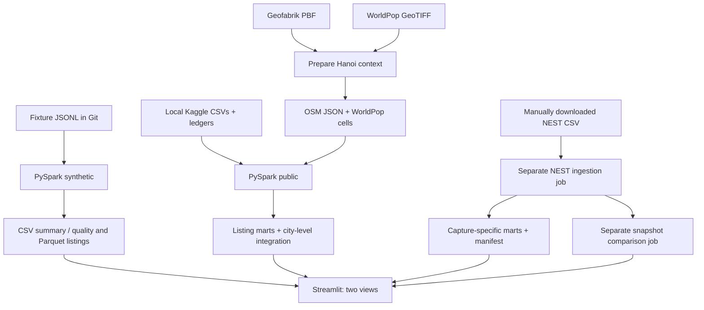

# IT5427 - Hanoi apartment rental data integration

An academic prototype for **Direction 1**: ingest data in different formats, normalize it, check quality, integrate sources, store analytical tables, and present the results. PySpark runs locally with `local[2]`; the project does not implement a cluster or streaming system. The application interface, program messages, and this README use English.

**Quick demo:** clone the repository → set up the environment in section 3 → run `python pipeline.py` → open the dashboard with `?view=synthetic`. Generated fixtures are included in Git. The public workflow requires additional inputs outside Git, listed in section 5.

## 1. Implemented features and limitations

- Three fixture adapters simulate Batdongsan, Nha Tot, and Homedy: normalize prices and areas, check quality, deduplicate by `(source, source_listing_id)`, aggregate, and export tables. **These fixtures are not real listings**.
- The public workflow reads three CSVs from **one** Kaggle listing dataset, screens the Hanoi partition using title cues and manual review ledgers, and exports quality counts, curated listings, and summaries.
- OSM and WorldPop are prepared before Spark processing, then integrated with the listing summary at **Hanoi city level**, using `city_key=VN-HN`. Context is not joined to individual listings or neighborhoods.
- NEST has separate CSV ingestion and snapshot comparison jobs. Each row is an aggregate cell from NEST's own inventory. NEST remains separate from Kaggle, and its medians are not combined.
- The dashboard reads saved outputs. Opening it or changing filters does not automatically run Spark or download data.

The existing public outputs on the development machine contain 13,785 source rows, 3,284 Hanoi rows, 303 manually reviewed candidates, 106 titles suggesting likely whole-apartment rentals, and 102 rows with usable amounts and areas. Of those 102 rows, **92 have an unknown time basis**. Monthly rent statistics use only **9 records with a verified monthly basis and a matching structured amount**. This is a small historical sample assessed from titles; it does not establish completed transactions or market-wide estimates.

SHA-256 fingerprints link source records to review ledgers; they are not genuine listing IDs or a cross-platform deduplication mechanism. Listing records lack reliable coordinates and district/ward codes. WorldPop models population for 2020. OSM counts tagged features, and a way is not necessarily a unique road. OSM batch comparisons and NEST aggregate comparisons do not establish individual rental-listing changes or rental-listing Velocity. See the [data quality review](docs/data_quality_and_analysis_review.md).

## 2. Sources and observation grain

| Source | Role and observation grain | Access, attribution, and limitations |
|---|---|---|
| [Kaggle - Vietnam House Rent Dataset](https://www.kaggle.com/datasets/vanviethieuanh/vietnam-house-rent-dataset), [author's repository](https://github.com/vanviethieuanh/dataset/tree/main/house-rent) | One rental-oriented listing dataset: `hn.csv`, `hcm.csv`, `dn.csv`. Each row is a source record; rental, sale, and room-offer cues are mixed. | Van Viet Hieu Anh; the uploader declares CC0, but the original listing websites and upstream rights remain unverified. Keep raw files local. Kaggle may require an account; mirror URLs and hashes are recorded in the manifest. |
| [OSM / Geofabrik Vietnam](https://download.geofabrik.de/asia/vietnam.html) | Geographic objects in a PBF, prepared into one Hanoi aggregate JSON record. This is geographic context rather than rental listing data. | © [OpenStreetMap contributors](https://www.openstreetmap.org/copyright), ODbL 1.0. Use the pinned `vietnam-260930.osm.pbf` snapshot, rather than replacing it with `latest`. |
| [WorldPop Vietnam 2020](https://hub.worldpop.org/geodata/summary?id=6449) | Each raster pixel contains an estimated population count. The Hanoi clip has 408,151 valid cells, aggregated by Spark into one city row. | WorldPop / University of Southampton and the organizations named in the [official citation](https://doi.org/10.5258/SOTON/WP00645); CC BY 4.0. These are not observed population counts at individual addresses. |
| [NEST Living Hanoi Rent Index](https://nestliving.vn/rent-index), [terms](https://nestliving.vn/terms) | City, district, district × bedroom, and property-type cells. One cell may represent many homes; it is not one listing. | An **optional** local CSV. The source assessment dated October 29, 2026 did not identify an open license or explicit CSV reuse grant. Retain attribution and keep raw files outside Git. Use the CSV link provided on the page; do not crawl listings. |

Do not add **listing records**, **raster cells**, and **aggregate cells** together as a rental listing count. The October 29 NEST snapshot has 45 cells: 1 city, 10 district, 29 district-bedroom, and 5 property-type cells. Statistics are suppressed in 17 small-sample cells. The city cell covers multiple property types (894 homes, median 19.1 million VND/month); the separate **Apartment** cell has 708 homes and a median of 19.5 million. These two cells represent different populations. These are historical snapshot values, not current live figures.



## 3. Windows setup - CMD

The `cmd` blocks below are for **Command Prompt**. Run commands from the repository root. Paths such as `C:\Path\To\...` are placeholders that you must replace with your own installation paths.

Install Git, **64-bit Python 3.12**, and **JDK 17**. The development machine uses Python 3.12.1, Temurin 17.0.20.1, and PySpark 3.5.9. The full public requirements need Python >=3.12 because of `rasterio>=1.5`; the earlier Python 3.10 instructions do not cover the complete project.

```cmd
git clone https://github.com/anhnd210020/apartment-rental-hanoi.git
cd apartment-rental-hanoi
py -3.12 -m venv .venv
call .venv\Scripts\activate.bat
python -m pip install -r requirements-synthetic.txt
```

This private repository requires an account with access. You may activate an existing compatible Python environment instead of creating `.venv`; check `where python` and `python --version`. Install the full requirements when preparing public inputs:

```cmd
python -m pip install -r requirements.txt
```

The synthetic requirements include PySpark, pandas, Streamlit, Plotly, and pyarrow. The full requirements add osmium, rasterio, and shapely for geographic processing; NumPy is installed through the data packages' dependencies. pyarrow is declared explicitly so the dashboard can read Parquet. A separate Spark installation or Hadoop cluster is not required. See the [PySpark 3.5.9 installation documentation](https://spark.apache.org/docs/3.5.9/api/python/getting_started/install.html).

In CMD, after activating `.venv`:

```cmd
set "JAVA_HOME=C:\Path\To\JDK-17"
set "PATH=%JAVA_HOME%\bin;%PATH%"
set "PYSPARK_PYTHON=%CD%\.venv\Scripts\python.exe"
set "PYSPARK_DRIVER_PYTHON=%CD%\.venv\Scripts\python.exe"
java -version
python --version
```

`JAVA_HOME` points to the JDK directory, not its `bin` directory. Both `PYSPARK_*` variables must point to **the Python executable running your commands**; adjust them if you use an existing environment. CMD `set` commands apply only to the current terminal window.

The development machine also uses `winutils.exe` and `hadoop.dll` in `%HADOOP_HOME%\bin` for Spark/Hadoop file writes on Windows. Once you have a compatible native build verified by the group or built from appropriate Apache sources:

```cmd
set "HADOOP_HOME=C:\Path\To\Hadoop-Native"
set "PATH=%HADOOP_HOME%\bin;%PATH%"
```

The local directory is named `hadoop-3.3.6`, but the project **does not contain the binaries' download source or build logs**. The directory name alone cannot establish their supplier or actual build version. The binaries are not included in Git. Do not download an arbitrary `winutils` binary. The [sharing verification record](docs/sharing_verification.md) lists the local file hashes; the group must verify provenance/build information before supplying native dependencies for a new machine. Linux/WSL with Python and Java installed inside it is another option, but it was not tested during the sharing verification.

**Verified local configuration**, for the author's machine only:

```cmd
call D:\envs\dev\Scripts\activate.bat
set "JAVA_HOME=D:\Apps\Temurin17\jdk-17.0.20.1+1"
set "HADOOP_HOME=D:\Apps\hadoop-3.3.6"
set "PATH=%JAVA_HOME%\bin;%HADOOP_HOME%\bin;%PATH%"
set "PYSPARK_PYTHON=D:\envs\dev\Scripts\python.exe"
set "PYSPARK_DRIVER_PYTHON=D:\envs\dev\Scripts\python.exe"
```

**PowerShell alternative:** activate `.\.venv\Scripts\Activate.ps1`; use `$env:JAVA_HOME = 'C:\Path\To\JDK-17'`, `$env:HADOOP_HOME = 'C:\Path\To\Hadoop-Native'`, `$env:PATH = "$env:JAVA_HOME\bin;$env:HADOOP_HOME\bin;$env:PATH"`, `$env:PYSPARK_PYTHON = (Resolve-Path .\.venv\Scripts\python.exe).Path`, and `$env:PYSPARK_DRIVER_PYTHON = $env:PYSPARK_PYTHON`. You can call the Python executable directly without activating the environment, but still configure the worker/driver variables correctly. Keep PowerShell and CMD syntax separate.

## 4. Workflow A - Synthetic demonstration

```cmd
python pipeline.py
```

This reads only the three committed files in `data/fixtures/`: `batdongsan.jsonl`, `nhatot.jsonl`, and `homedy.jsonl`. Verified results: **7 raw, 7 active, 5 valid, 4 unique**. These are generated test fixtures, not actual rental listings from the three platforms.

Local outputs are `data/curated/listings/` (deduplicated Parquet), `data/mart/summary/` (summary CSV), and `data/mart/quality/` (CSV counts by source/reason). Spark writes `part-*` files and `_SUCCESS` markers. The synthetic workflow has no separate run manifest. Outputs are not committed. This workflow runs from a clean clone after installing the Python, Java, and native Windows dependencies.

## 5. Workflow B - Public-data processing

**A clean clone has no raw data or prepared context.** The two minimal ledgers in `reproducibility/curation/` preserve the existing fingerprints and review decisions without titles, addresses, contact details, or listing content. Source row numbers and notes containing specific source amounts were omitted from the shared copies because the pipeline does not need them. Local working ledgers retain their original contents.

| Required path | Source / preparation |
|---|---|
| `data/raw/public_datasets/kaggle_vietnam_house_rent/hn.csv`, `hcm.csv`, `dn.csv` | CSVs matching the sizes/hashes in `public_data_manifest.json`, obtained from the author/mirror or a group copy you are permitted to use. |
| `data/raw/public_datasets/geofabrik/vietnam-260930.osm.pbf` | Geofabrik snapshot dated September 30, 2026, approximately 329 MB. |
| `data/raw/public_datasets/worldpop/vnm_ppp_2020.tif` | WorldPop Vietnam 2020 file specified in the manifest, approximately 197 MB. |
| `data/raw/public_datasets/manifest.json` | Copy the historical provenance record from `reproducibility/public_inputs.manifest.json`. |
| `data/curation/kaggle_hanoi_title_review.csv` | Copy the 303-row metadata file from `reproducibility/curation/`; Spark reads `source_fingerprint`, `review_status`, and `review_reason`. |
| `data/curation/kaggle_price_period_review.csv` | Copy the 11-row metadata file; Spark reads `source_fingerprint`, `explicit_price_period`, and `monthly_amount_status`. Only the 9 `monthly` + `verified_match` records enter monthly statistics. |
| `data/public_pilot/context/hanoi_context.json` | `prepare_public_context.py` creates the OSM aggregate JSON and WorldPop metadata. |
| `data/public_pilot/context/tables/worldpop_hanoi_cells.csv.gz`, `worldpop_hanoi_cells.schema.json` | `prepare_worldpop_cells.py` creates these from the Hanoi-clipped raster. |

`context/hanoi_boundary.geojson` and `context/worldpop_hanoi_2020.tif` are geographic preparation outputs needed to prepare/rebuild the cell table; both remain outside Git. `data/curation/kaggle_title_audit_sample.csv` supports the audit described in the report, but **is not required to run the pipeline** and is not included in the minimal shared metadata.

Install `requirements.txt` and review the sources' access/use conditions before downloading. On a new clone:

```cmd
python download_public_data.py
copy reproducibility\public_inputs.manifest.json data\raw\public_datasets\manifest.json
mkdir data\curation
copy reproducibility\curation\kaggle_hanoi_title_review.csv data\curation\kaggle_hanoi_title_review.csv
copy reproducibility\curation\kaggle_price_period_review.csv data\curation\kaggle_price_period_review.csv
python prepare_public_context.py
python prepare_worldpop_cells.py
python pipeline.py --dataset public
```

The downloader processes only the five entries in the manifest's `files` array and verifies byte sizes and SHA-256 hashes. It does not download NEST or ledgers, and it does not create the raw manifest automatically. The copied manifest records **the group's historical download time**, not the download you just performed; a new run manifest records the new processing time. Preserve your own ledger before copying if you have edited it. If a historical URL no longer serves the exact file, obtain a permitted copy with the matching hash from the group. Do not substitute `latest`, change hashes, or invent labels to reproduce the old counts.

The first context preparation scans the PBF and clips the raster, which may require substantial memory and time. `prepare_public_context.py` reuses existing context/raster outputs; `--rebuild` forces reprocessing. `prepare_worldpop_cells.py` automatically reuses its table when the raster hash matches. It **has no `--rebuild` CLI option**; that parameter exists only on its internal function.

The group may provide the exact prepared context files listed above when sharing is permitted. **Downloading raw CSVs alone does not reproduce the public results.** Viewing saved outputs does not require rerunning Spark.

Outputs under `data/public_pilot/` include `curated/listings/`, `mart/quality/`, `mart/summary/`, `mart/osm_city_context/`, `mart/worldpop_city_context/`, `mart/city_context/`, `mart/integrated_city/`, and `context/tables/worldpop_hanoi_cells_parquet/`. `mart/run_manifest.json` records the run ID, timestamps, lineage, row counts/grains, hashes, Parquet payload sizes, and stage timings. Context is joined only to the city summary; curated listing records do not receive address-level context.

## 6. Workflow C - NEST ingestion and snapshot comparison

These are **two separate jobs** and do not run automatically in the public pipeline. Ingestion reads a manually downloaded CSV with the expected schema and its **actual retrieval timestamp with a time zone**. It does not contact the NEST website. The following commands apply only when you have the exact historical snapshots described in the [NEST source note](docs/nest_living_source_note.md) and permission to use them:

```cmd
python ingest_nest_rent_index.py --input data\raw\nest_living\snapshots\nest_hanoi_rent_index_20261029T082644540Z.csv --retrieved-at-utc 2026-10-29T08:27:06.485Z
python ingest_nest_rent_index.py --input data\raw\nest_living\snapshots\nest_hanoi_rent_index_20261029T091525078Z.csv --retrieved-at-utc 2026-10-29T09:18:31.870Z
python compare_nest_snapshots.py
```

For another file, replace `--input` and `--retrieved-at-utc` with the real values. Do not reuse an example timestamp for a new download. The source `captured_at` value determines the snapshot ID. Ingestion stores the CSV and `.manifest.json` in `data/raw/nest_living/snapshots/`, then writes Parquet `cells`, `city`, `district`, `district_bedroom`, and `property_type` tables plus a manifest under `data/public_pilot/mart/nest_rent_index/<snapshot-id>/`. `latest.json` points to the most recently ingested capture, so ingest in chronological order.

The comparator supports `--snapshot-dir` and `--output`. By default it compares the two latest captures by source timestamp and writes `data/public_pilot/snapshot_comparison/nest_living_latest.json`. With fewer than two captures it records `insufficient_snapshots`. The October 29 pair has 45 shared cells, 7 changed, 38 unchanged, and 0 added/removed. These are **aggregate-cell changes**, not individual listing changes.

`compare_geofabrik_snapshots.py` is a separate OSM batch job with `--old-manifest`, `--new-manifest`, and `--output`. It requires frozen manifests under `data/public_pilot/snapshot_comparison/manifests/`, the PBF/update `.osc.gz` files, and the boundary referenced by those manifests, all outside Git. This job is not needed for the normal synthetic/public demonstration. See the [public implementation notes](docs/public_data_implementation.md).

## 7. Workflow D - Dashboard and quick demo

```cmd
python -m streamlit run dashboard.py --server.port 8501
```

Open <http://127.0.0.1:8501/?view=synthetic> and select **Synthetic fixtures** to explore the generated fixtures and filter by source/property type. Open <http://127.0.0.1:8501/?view=public> or select **Public-data prototype** to read saved public outputs. Without a query parameter, the default is public. A new clone displays guidance about missing outputs instead of generating data automatically.

The public view contains **Kaggle - Screening and listed amounts** (quality and unknown time bases), **Kaggle - Verified monthly subset** (n=9), **Hanoi context - OSM and WorldPop** (city grain), **NEST Living - Separate aggregate statistics** (city versus Apartment cells, suppression, and snapshot comparison), **Spark - Processing and provenance**, and source attribution. When the main public outputs are available, missing NEST inputs result in an optional-input notice.

The synthetic view reads `data/mart/{summary,quality}/`. The public view requires at least `data/public_pilot/mart/{summary,quality,city_context}/`. For the complete view, obtain the full `mart/` directory and the raw provenance manifests referenced by `nest_rent_index/latest.json` and the snapshot manifests. Preserve the directory structure and relative paths. The dashboard does not rerun processing. After outputs change, use **Clear cache** in the Streamlit menu or restart the server.

A short demo sequence: run the fixtures → explain 7/7/5/4 → switch to public if its outputs are available → explain the time-basis caveat and n=9 subset → show city context → distinguish NEST city and Apartment cells → show lineage. Stop the server with **Ctrl+C** in its terminal. If the port is occupied:

```cmd
python -m streamlit run dashboard.py --server.port 8502
```

Open the corresponding URL on port 8502. Reading saved outputs does not require Java/Spark; the Python packages used to read and display tables are still required.

## 8. Repository structure and exploring the code

| Script/directory | Responsibility |
|---|---|
| `pipeline.py` | Synthetic workflow; `--dataset public`; the legacy `--dataset bds-pilot` requires `data/raw/batdongsan/g1_20261002/listings.jsonl` outside Git. |
| `dashboard.py` | Reads tables/manifests and presents two views; does not process raw inputs. |
| `download_public_data.py` | Downloads/verifies pinned raw inputs using the manifest; has no argparse CLI. |
| `prepare_public_context.py` | Uses osmium/rasterio/shapely to prepare the boundary, OSM context, and raster clip; supports `--rebuild`. |
| `prepare_worldpop_cells.py` | Converts the clipped raster into a gzip cell CSV and schema/provenance record; has no argparse CLI. |
| `ingest_nest_rent_index.py` | Validates schema, suppression, and grain; registers the NEST CSV and builds Spark marts. |
| `compare_nest_snapshots.py`, `compare_geofabrik_snapshots.py` | Compare NEST aggregate snapshots and OSM batches as independent jobs. |
| `data/fixtures/` | Three committed synthetic JSONL files. Real raw/context/mart files under `data/` are ignored. |
| `reproducibility/` | Historical raw-input provenance and two minimal ledgers; no raw listing content. |
| `public_data_manifest.json` | Pinned raw URLs, sizes, hashes, and optional NEST source records; distinct from an output run manifest. |
| `docs/reproduce_data_quality_funnel.py` | Checks existing raw inputs/ledgers/marts and draws the funnel to a `*_reproduced.png` file; requires matplotlib and pyarrow. |
| `docs/reproduce_nest_property_types_vi.py` | Retains its historical filename; chart labels now use English. Validates the October 29 NEST capture and draws a separate image; requires pandas, pyarrow, matplotlib, and historical raw/mart/manifest files. |
| `docs/generate_project_figures.py` | Generates architecture/NEST figures from local data; requires matplotlib. |
| `docs/export_final_report.py`, `docs/assemble_final_report.py` | Export/assemble reports using Word, pywin32, markdown, and python-docx/docxcompose as applicable. Assembly also requires a cover document outside the repository. |
| `docs/build_final_presentation.py` | Builds slides through PowerPoint COM; requires Office, pywin32, and Pillow. |
| `build_submission_zip.py` | Packages source/documentation while excluding local data. Use `--output` with a new destination if needed; historical ZIPs may differ from the current code. |
| `docs/`, `submission/` | Documentation, reports, slides, figures, and historical submissions; these do not contain all public inputs. |

Start with `pipeline.py:main()`, then read `normalize_fixture()` or `run_public()`. Compare output schemas/manifests with the dashboard's `load_*` functions. Scripts with argparse support `python <script>.py --help`; do not add options to scripts without a parser.

The [DOCX report](docs/IT5427_Final_Report_2026-10-29.docx), [PDF](docs/IT5427_Final_Report_2026-10-29.pdf), [slides](docs/IT5427_final_presentation.pptx), and [runbook](docs/demo_runbook.md) retain their historical contents. Rebuilding them is not required for the demo; older screenshots may use a different interface language.

## 9. Common errors

| Symptom | Fix |
|---|---|
| Python/Java not found, or the wrong environment is active | Activate the intended environment and check `where python`, `where java`, `JAVA_HOME`, and PATH. |
| `JAVA_GATEWAY_EXITED` | Check `java -version`, use JDK 17, and point `JAVA_HOME` to the JDK directory. Read the Java error preceding the final message. |
| Python worker fails to start / version mismatch | Point both `PYSPARK_*` variables to the running Python executable and retry in the configured terminal. |
| Missing `winutils.exe`/`hadoop.dll`, or a native error during Windows writes | Check `%HADOOP_HOME%\bin`, PATH, 64-bit compatibility, and the build/provenance with the group. Do not download an unverified binary. |
| `ModuleNotFoundError` / Parquet cannot be read | Run `python -m pip install -r requirements.txt` using the intended Python. The public dashboard needs pyarrow. |
| rasterio cannot be installed on Python 3.10/3.11 | Use 64-bit Python 3.12 for the current full requirements. |
| `PATH_NOT_FOUND`, missing ledger/raw manifest/WorldPop table | Complete the checklist and copy/preparation commands in section 5. |
| Raw hash/size mismatch | Keep the mismatched copy separate and obtain the correct snapshot. Do not change hashes or substitute `latest` to bypass validation. |
| Spark WorldPop totals disagree with the context | Verify that context, raster, CSV, and schema describe the same snapshot. Rebuild inconsistent artifacts after checking inputs; do not edit population totals manually. |
| Dashboard reports missing data | Run the correct pipeline or obtain complete saved outputs. Synthetic and public outputs use separate directory trees. |
| NEST is missing / insufficient snapshots | Check capture-specific manifests/marts and `latest.json`. Comparison requires two genuine captures. |
| Port occupied / stale displayed data | Stop the server you started or use port 8502. Clear the cache/restart after outputs change. |

## 10. Reproducibility and shared contents

Git contains code, requirements, fixtures, minimal review metadata, and documentation. `.gitignore` excludes raw inputs, working ledgers, local context/marts, environments, Java/Hadoop installations, and caches. It does not automatically remove historical documents already tracked.

A clean clone runs the synthetic workflow after dependency installation. The public workflow needs the pinned raw inputs and preparation steps in section 5. To demonstrate saved outputs, obtain the appropriate `data/public_pilot/` bundle and permission to use it from the group. Optional NEST data also needs the raw provenance manifests referenced by its marts. Raw listing/NEST files are not included in Git. No substitute data, labels, or snapshots were created to satisfy verification.

The [sharing verification record](docs/sharing_verification.md) documents the checks actually performed, dependency provenance, and checks not run. Historical reports refer to their own run IDs; they are not evidence that public processing was rerun during GitHub preparation.
