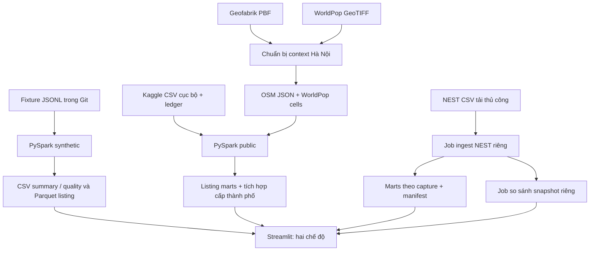

# IT5427 - Tích hợp dữ liệu thuê căn hộ Hà Nội

Prototype học thuật theo **Hướng 1 (Direction 1)**: thu nhận dữ liệu khác định dạng, chuẩn hóa, kiểm tra chất lượng, tích hợp, lưu bảng phân tích và trình bày kết quả. PySpark chạy cục bộ `local[2]`; chưa triển khai cluster hoặc streaming. Giao diện và thông báo chương trình dùng tiếng Anh; README giải thích bằng tiếng Việt.

**Demo nhanh:** clone → cài môi trường ở mục 3 → `python pipeline.py` → mở dashboard ở `?view=synthetic`. Fixture giả lập đã có trong Git. Luồng public cần thêm dữ liệu ngoài Git theo mục 5.

## 1. Đã triển khai và giới hạn

- Ba adapter fixture mô phỏng Batdongsan, Nhà Tốt, Homedy: chuẩn hóa giá/diện tích, kiểm tra chất lượng, khử trùng lặp theo `(source, source_listing_id)`, tổng hợp và xuất bảng. **Fixture không phải listing thật**.
- Public: đọc ba CSV của **một** bộ listing Kaggle, sàng lọc Hà Nội bằng tín hiệu trong tiêu đề và ledger rà soát thủ công; xuất quality, curated listings và summary.
- OSM và WorldPop được chuẩn bị trước rồi tích hợp với summary listing ở **cấp thành phố Hà Nội**, khóa `city_key=VN-HN`. Không nối context tới từng listing hoặc khu phố.
- NEST có job nhập CSV và job so sánh snapshot riêng. Mỗi dòng là ô thống kê từ kho nhà của NEST; nguồn này giữ riêng, không nối vào Kaggle và không gộp các trung vị.
- Dashboard đọc output đã lưu. Mở dashboard và đổi bộ lọc không tự chạy Spark hoặc tải dữ liệu.

Output public đã lưu tại máy phát triển có 13.785 dòng nguồn, 3.284 dòng Hà Nội, 303 ứng viên được rà soát, 106 tiêu đề có khả năng cho thuê căn hộ nguyên căn, 102 dòng có khoản tiền và diện tích dùng được. Trong 102 dòng, **92 chưa rõ kỳ giá**; thống kê tiền thuê tháng chỉ dùng **9 dòng có kỳ tháng và khoản tiền được xác minh khớp**. Đây là mẫu lịch sử nhỏ, dựa trên tiêu đề; không phải giao dịch hoặc ước lượng thị trường.

Fingerprint SHA-256 dùng để nối ledger, không phải ID listing thật hoặc cơ chế khử trùng lặp liên nền tảng. Listing thiếu tọa độ/mã quận phường đáng tin cậy. WorldPop là mô hình dân số năm 2020; OSM đếm feature có tag, way không đồng nghĩa tuyến đường duy nhất. So sánh OSM batch và NEST aggregate không chứng minh thay đổi từng tin thuê (rental-listing Velocity). Xem [kiểm tra chất lượng](docs/data_quality_and_analysis_review.md).

## 2. Nguồn và đơn vị quan sát

| Nguồn | Vai trò và đơn vị quan sát | Truy cập, ghi công, giới hạn |
|---|---|---|
| [Kaggle - Vietnam House Rent Dataset](https://www.kaggle.com/datasets/vanviethieuanh/vietnam-house-rent-dataset), [repository tác giả](https://github.com/vanviethieuanh/dataset/tree/main/house-rent) | Một bộ listing hướng tới cho thuê; `hn.csv`, `hcm.csv`, `dn.csv`. Một dòng là bản ghi nguồn; có tín hiệu thuê/bán/phòng ở lẫn nhau. | Van Viet Hieu Anh; uploader khai báo CC0 nhưng nguồn website listing gốc/quyền upstream chưa xác minh. Giữ raw cục bộ. Kaggle có thể cần tài khoản; mirror/hash nằm trong manifest. |
| [OSM / Geofabrik Vietnam](https://download.geofabrik.de/asia/vietnam.html) | Đối tượng địa lý trong PBF; chuẩn bị thành một JSON tổng hợp Hà Nội. Không phải listing thuê. | © [OpenStreetMap contributors](https://www.openstreetmap.org/copyright), ODbL 1.0. Dùng bản cố định `vietnam-260930.osm.pbf`, không thay bằng `latest`. |
| [WorldPop Vietnam 2020](https://hub.worldpop.org/geodata/summary?id=6449) | Mỗi pixel raster là số người ước lượng; clip Hà Nội có 408.151 ô hợp lệ, Spark tổng hợp thành một dòng thành phố. | WorldPop / University of Southampton và các đơn vị trong [trích dẫn chính thức](https://doi.org/10.5258/SOTON/WP00645); CC BY 4.0. Không phải dân số quan sát ở từng địa chỉ. |
| [NEST Living Hanoi Rent Index](https://nestliving.vn/rent-index), [điều khoản](https://nestliving.vn/terms) | Ô city, district, district × bedroom, property type. Một ô có thể đại diện nhiều homes; không phải một listing. | CSV cục bộ **tùy chọn**. Hồ sơ nguồn 29/10/2026 chưa xác định giấy phép mở/quyền tái sử dụng CSV rõ ràng. Giữ ghi công và raw ngoài Git. Dùng liên kết CSV của trang; không crawl listing. |

Không cộng **listing records**, **raster cells**, **aggregate cells** thành số tin thuê. Snapshot NEST 29/10 có 45 ô: 1 city, 10 district, 29 district-bedroom, 5 property type; 17 ô bị ẩn thống kê vì mẫu nhỏ. Ô city gồm nhiều loại bất động sản (894 homes, trung vị 19,1 triệu VND/tháng); ô **Apartment** riêng có 708 homes, trung vị 19,5 triệu. Hai ô có tập quan sát khác nhau. Đây là snapshot lịch sử, không phải dữ liệu trực tiếp hiện tại.



## 3. Cài đặt Windows - CMD

Các khối `cmd` dành cho **Command Prompt**. Chạy từ thư mục gốc repository. Đường dẫn `C:\Path\To\...` là ví dụ cần thay bằng cài đặt của bạn.

Cần Git, Python **3.12 64-bit**, JDK **17**. Máy phát triển dùng Python 3.12.1, Temurin 17.0.20.1 và PySpark 3.5.9. Bộ requirements public yêu cầu Python >=3.12 vì `rasterio>=1.5`; hướng dẫn Python 3.10 cũ không áp dụng cho toàn bộ project.

```cmd
git clone https://github.com/anhnd210020/apartment-rental-hanoi.git
cd apartment-rental-hanoi
py -3.12 -m venv .venv
call .venv\Scripts\activate.bat
python -m pip install -r requirements-synthetic.txt
```

Repository private cần tài khoản đã được cấp quyền. Có thể kích hoạt môi trường Python phù hợp có sẵn thay cho `.venv`; kiểm tra `where python`, `python --version`. Cài đầy đủ khi cần chuẩn bị public:

```cmd
python -m pip install -r requirements.txt
```

Synthetic cần PySpark, pandas, Streamlit, Plotly, pyarrow. Full requirements thêm osmium, rasterio, shapely cho địa lý; NumPy được kéo theo gói dữ liệu. pyarrow được khai báo để dashboard đọc Parquet. Không cần cài Spark riêng hoặc Hadoop cluster. Tham khảo [PySpark 3.5.9](https://spark.apache.org/docs/3.5.9/api/python/getting_started/install.html).

Trong CMD đã kích hoạt `.venv`:

```cmd
set "JAVA_HOME=C:\Path\To\JDK-17"
set "PATH=%JAVA_HOME%\bin;%PATH%"
set "PYSPARK_PYTHON=%CD%\.venv\Scripts\python.exe"
set "PYSPARK_DRIVER_PYTHON=%CD%\.venv\Scripts\python.exe"
java -version
python --version
```

`JAVA_HOME` trỏ tới JDK, không phải `bin`. Hai biến `PYSPARK_*` phải trỏ tới **Python đang chạy lệnh**; thay đường dẫn nếu dùng môi trường có sẵn. `set` chỉ áp dụng trong cửa sổ CMD hiện tại.

Máy phát triển dùng thêm `winutils.exe` và `hadoop.dll` ở `%HADOOP_HOME%\bin` để Spark/Hadoop ghi file trên Windows. Khi đã có bản native được nhóm xác minh hoặc tự build từ nguồn Apache phù hợp:

```cmd
set "HADOOP_HOME=C:\Path\To\Hadoop-Native"
set "PATH=%HADOOP_HOME%\bin;%PATH%"
```

Thư mục cục bộ tên `hadoop-3.3.6`, nhưng project **không có nguồn tải/build log** của hai binary; chưa thể xác nhận nhà cung cấp hoặc phiên bản nội tại từ tên thư mục. Binary không được đưa vào Git. Không dùng bản `winutils` tải ngẫu nhiên. [Biên bản chia sẻ](docs/sharing_verification.md) ghi hash bản cục bộ; nhóm cần xác minh provenance/build trước khi cấp native dependency cho máy mới. Linux/WSL với Python/Java cài bên trong là lựa chọn khác, chưa được thử trong lần chia sẻ này.

**Cấu hình cục bộ đã kiểm tra**, chỉ dành cho máy tác giả:

```cmd
call D:\envs\dev\Scripts\activate.bat
set "JAVA_HOME=D:\Apps\Temurin17\jdk-17.0.20.1+1"
set "HADOOP_HOME=D:\Apps\hadoop-3.3.6"
set "PATH=%JAVA_HOME%\bin;%HADOOP_HOME%\bin;%PATH%"
set "PYSPARK_PYTHON=D:\envs\dev\Scripts\python.exe"
set "PYSPARK_DRIVER_PYTHON=D:\envs\dev\Scripts\python.exe"
```

**PowerShell thay thế:** kích hoạt `.\.venv\Scripts\Activate.ps1`; dùng `$env:JAVA_HOME = 'C:\Path\To\JDK-17'`, `$env:HADOOP_HOME = 'C:\Path\To\Hadoop-Native'`, `$env:PATH = "$env:JAVA_HOME\bin;$env:HADOOP_HOME\bin;$env:PATH"`, `$env:PYSPARK_PYTHON = (Resolve-Path .\.venv\Scripts\python.exe).Path`, `$env:PYSPARK_DRIVER_PYTHON = $env:PYSPARK_PYTHON`. Có thể gọi Python trực tiếp khi không kích hoạt, vẫn đặt đúng worker/driver. Không trộn cú pháp PowerShell với CMD.

## 4. Luồng A - Synthetic demonstration

```cmd
python pipeline.py
```

Chỉ đọc ba tệp đã commit trong `data/fixtures/`: `batdongsan.jsonl`, `nhatot.jsonl`, `homedy.jsonl`. Kết quả đã kiểm tra: **7 raw, 7 active, 5 valid, 4 unique**. Đây là dữ liệu giả lập để kiểm thử, không phải tin thuê thực tế của ba nền tảng.

Output cục bộ: `data/curated/listings/` (Parquet sau dedup), `data/mart/summary/` (CSV tổng hợp), `data/mart/quality/` (CSV số dòng theo nguồn/lý do). Spark ghi `part-*` và `_SUCCESS`; không có run manifest riêng cho synthetic. Output không commit. Luồng này chạy từ clone sạch sau khi cài dependency Python/Java/native Windows.

## 5. Luồng B - Public-data processing

**Clone sạch chưa có raw hoặc context.** Hai ledger tối thiểu trong `reproducibility/curation/` giữ nguyên fingerprint/quyết định hiện có, không chứa tiêu đề, địa chỉ, liên hệ hoặc nội dung listing. Số dòng nguồn và ghi chú chứa khoản tiền cụ thể không cần cho pipeline đã được bỏ khỏi bản chia sẻ; ledger làm việc cục bộ vẫn giữ nguyên.

| Đường dẫn bắt buộc | Lấy từ đâu / cách tạo |
|---|---|
| `data/raw/public_datasets/kaggle_vietnam_house_rent/hn.csv`, `hcm.csv`, `dn.csv` | CSV đúng kích thước/hash trong `public_data_manifest.json`, từ tác giả/mirror hoặc bản nhóm được phép dùng. |
| `data/raw/public_datasets/geofabrik/vietnam-260930.osm.pbf` | Geofabrik snapshot 30/09/2026, khoảng 329 MB. |
| `data/raw/public_datasets/worldpop/vnm_ppp_2020.tif` | WorldPop Vietnam 2020 theo manifest, khoảng 197 MB. |
| `data/raw/public_datasets/manifest.json` | Copy bản provenance lịch sử từ `reproducibility/public_inputs.manifest.json`. |
| `data/curation/kaggle_hanoi_title_review.csv` | Copy metadata 303 dòng từ `reproducibility/curation/`; Spark đọc `source_fingerprint`, `review_status`, `review_reason`. |
| `data/curation/kaggle_price_period_review.csv` | Copy metadata 11 dòng; Spark đọc `source_fingerprint`, `explicit_price_period`, `monthly_amount_status`. Chỉ 9 dòng `monthly` + `verified_match` dùng cho thống kê tháng. |
| `data/public_pilot/context/hanoi_context.json` | `prepare_public_context.py` tạo JSON tổng hợp OSM và metadata WorldPop. |
| `data/public_pilot/context/tables/worldpop_hanoi_cells.csv.gz`, `worldpop_hanoi_cells.schema.json` | `prepare_worldpop_cells.py` tạo từ raster Hà Nội đã clip. |

`context/hanoi_boundary.geojson` và `context/worldpop_hanoi_2020.tif` là sản phẩm chuẩn bị địa lý, cần cho việc chuẩn bị/tạo lại bảng cells, đều ngoài Git. `data/curation/kaggle_title_audit_sample.csv` phục vụ audit trong báo cáo, **không cần để chạy pipeline** và không có trong bản metadata tối thiểu.

Cài `requirements.txt`, kiểm điều kiện truy cập/sử dụng nguồn trước khi tải. Trên clone mới:

```cmd
python download_public_data.py
copy reproducibility\public_inputs.manifest.json data\raw\public_datasets\manifest.json
mkdir data\curation
copy reproducibility\curation\kaggle_hanoi_title_review.csv data\curation\kaggle_hanoi_title_review.csv
copy reproducibility\curation\kaggle_price_period_review.csv data\curation\kaggle_price_period_review.csv
python prepare_public_context.py
python prepare_worldpop_cells.py
python pipeline.py --dataset public
```

Downloader chỉ tải năm tệp trong mảng `files`, kiểm byte và SHA-256; không tải NEST/ledger và không tự tạo raw manifest. Manifest copy lưu **ngày tải lịch sử của nhóm**, không phải ngày tải vừa thực hiện trên máy bạn; run manifest mới ghi thời gian chạy mới. Giữ ledger riêng trước khi copy nếu đã chỉnh sửa. Nếu URL lịch sử không còn phục vụ đúng tệp, xin nhóm bản được phép dùng có hash khớp; không thay `latest`, sửa hash hoặc tự gán nhãn để đạt số lượng cũ.

Lần đầu chuẩn bị context phải quét PBF/clip raster, có thể tốn RAM và thời gian. `prepare_public_context.py` tái dùng context/raster có sẵn, chỉ `--rebuild` mới ép xử lý lại. `prepare_worldpop_cells.py` tự tái dùng bảng khi hash raster khớp; **không có CLI `--rebuild`** (tham số đó chỉ có ở hàm nội bộ).

Nhóm có thể cấp đúng bộ prepared context nêu trên nếu có quyền chia sẻ. **Chỉ tải raw CSV không tái lập được public.** Muốn xem output đã lưu thì không cần chạy Spark lại.

Output dưới `data/public_pilot/`: `curated/listings/`, `mart/quality/`, `mart/summary/`, `mart/osm_city_context/`, `mart/worldpop_city_context/`, `mart/city_context/`, `mart/integrated_city/`, `context/tables/worldpop_hanoi_cells_parquet/`. `mart/run_manifest.json` ghi run ID, thời gian, lineage, số dòng/grain, hash, kích thước payload Parquet và thời gian từng stage. Context chỉ nối với summary thành phố; curated listing không nhận context từng địa chỉ.

## 6. Luồng C - NEST và so sánh snapshot

Đây là **hai job riêng**, không tự chạy trong public pipeline. Ingest đọc CSV tải thủ công đúng schema và **thời điểm tải thực tế có múi giờ**; không liên hệ website NEST. Các lệnh sau chỉ đúng khi có chính hai snapshot lịch sử trong [hồ sơ NEST](docs/nest_living_source_note.md) và được phép sử dụng:

```cmd
python ingest_nest_rent_index.py --input data\raw\nest_living\snapshots\nest_hanoi_rent_index_20261029T082644540Z.csv --retrieved-at-utc 2026-10-29T08:27:06.485Z
python ingest_nest_rent_index.py --input data\raw\nest_living\snapshots\nest_hanoi_rent_index_20261029T091525078Z.csv --retrieved-at-utc 2026-10-29T09:18:31.870Z
python compare_nest_snapshots.py
```

Với tệp khác, thay `--input` và `--retrieved-at-utc` bằng giá trị thật; không dùng timestamp ví dụ cho lần tải mới. `captured_at` lấy từ nguồn và quyết định snapshot ID. Ingest lưu CSV + `.manifest.json` ở `data/raw/nest_living/snapshots/`, Parquet `cells`, `city`, `district`, `district_bedroom`, `property_type` + manifest tại `data/public_pilot/mart/nest_rent_index/<snapshot-id>/`. `latest.json` trỏ tới capture được ingest gần nhất; nên nhập theo thứ tự thời gian.

Comparator có `--snapshot-dir`, `--output`; mặc định so hai capture mới nhất theo thời gian nguồn và ghi `data/public_pilot/snapshot_comparison/nest_living_latest.json`. Dưới hai capture sẽ ghi `insufficient_snapshots`. Cặp 29/10 có 45 ô chung, 7 thay đổi, 38 không đổi, 0 thêm/bớt: thay đổi **ô tổng hợp**, không phải từng listing.

`compare_geofabrik_snapshots.py` là job OSM batch độc lập, có `--old-manifest`, `--new-manifest`, `--output`. Cần manifest đóng băng ở `data/public_pilot/snapshot_comparison/manifests/`, PBF/update `.osc.gz` và boundary được chúng tham chiếu, tất cả ngoài Git. Không cần job này cho demo synthetic/public thông thường; xem [tài liệu public](docs/public_data_implementation.md).

## 7. Luồng D - Dashboard và demo nhanh

```cmd
python -m streamlit run dashboard.py --server.port 8501
```

Mở <http://127.0.0.1:8501/?view=synthetic> và chọn **Synthetic fixtures** để xem fixture/lọc nguồn và loại nhà. Mở <http://127.0.0.1:8501/?view=public> hoặc chọn **Public-data prototype** để đọc output public. Mặc định không có query là public; clone mới sẽ hiện hướng dẫn thiếu output, không tự tạo dữ liệu.

Public view gồm **Kaggle - Screening and listed amounts** (quality/kỳ giá chưa rõ), **Kaggle - Verified monthly subset** (n=9), **Hanoi context - OSM and WorldPop** (cấp thành phố), **NEST Living - Separate aggregate statistics** (city khác Apartment, suppression, so snapshot), **Spark - Processing and provenance**, nguồn và ghi công. Thiếu NEST chỉ hiện thông báo tùy chọn khi các output public chính đã đủ.

Synthetic đọc `data/mart/{summary,quality}/`. Public cần tối thiểu `data/public_pilot/mart/{summary,quality,city_context}/`; để xem đầy đủ, nhận cả `mart/` và raw provenance manifests mà `nest_rent_index/latest.json`/manifest snapshot tham chiếu. Giữ nguyên cây thư mục/đường dẫn tương đối. Dashboard không chạy lại xử lý; sau khi output đổi, dùng **Clear cache** trong menu Streamlit hoặc khởi động lại server.

Demo ngắn: chạy fixture → giải thích 7/7/5/4 → nếu đã có output public, chuyển public → đọc caveat kỳ giá và n=9 → xem context thành phố → phân biệt city/Apartment NEST → xem lineage. Dừng bằng **Ctrl+C** tại terminal. Nếu cổng bận:

```cmd
python -m streamlit run dashboard.py --server.port 8502
```

Mở URL cổng 8502 tương ứng. Chỉ đọc output đã lưu không cần Java/Spark; Python và dependency đọc/hiển thị bảng vẫn cần cài.

## 8. Cấu trúc và cách khám phá mã

| Script/thư mục | Trách nhiệm |
|---|---|
| `pipeline.py` | Nhánh synthetic; `--dataset public`; pilot cũ `--dataset bds-pilot` cần `data/raw/batdongsan/g1_20261002/listings.jsonl` ngoài Git. |
| `dashboard.py` | Đọc bảng/manifest, hiển thị hai view; không đọc raw để xử lý. |
| `download_public_data.py` | Tải/kiểm hash raw theo manifest; không có argparse. |
| `prepare_public_context.py` | osmium/rasterio/shapely: boundary, OSM context, raster clip; có `--rebuild`. |
| `prepare_worldpop_cells.py` | Raster clip → gzip CSV cells + schema/provenance; không có argparse. |
| `ingest_nest_rent_index.py` | Kiểm schema/suppression/grain, đăng ký CSV NEST, tạo marts bằng Spark. |
| `compare_nest_snapshots.py`, `compare_geofabrik_snapshots.py` | So snapshot aggregate NEST và batch OSM, hai job độc lập. |
| `data/fixtures/` | Ba JSONL giả lập đã commit. Raw/context/mart thật trong `data/` bị ignore. |
| `reproducibility/` | Provenance raw lịch sử + hai ledger tối thiểu; không có listing thô. |
| `public_data_manifest.json` | URL, byte, hash raw cố định và hồ sơ NEST tùy chọn; khác run manifest đầu ra. |
| `docs/reproduce_data_quality_funnel.py` | Kiểm raw/ledger/marts hiện có, vẽ funnel vào ảnh `*_reproduced.png`; cần matplotlib, pyarrow. |
| `docs/reproduce_nest_property_types_vi.py` | Giữ tên tệp lịch sử; nhãn biểu đồ hiện bằng tiếng Anh. Kiểm capture NEST 29/10, vẽ ảnh riêng; cần pandas, pyarrow, matplotlib và raw/mart/manifest lịch sử. |
| `docs/generate_project_figures.py` | Tạo hình kiến trúc/NEST từ dữ liệu cục bộ; cần matplotlib. |
| `docs/export_final_report.py`, `docs/assemble_final_report.py` | Xuất/ghép báo cáo: Word, pywin32, markdown, python-docx/docxcompose tùy script. Assemble cần bìa ngoài repository. |
| `docs/build_final_presentation.py` | Dựng slide qua PowerPoint COM; cần Office, pywin32, Pillow. |
| `build_submission_zip.py` | Đóng gói nguồn/tài liệu, loại dữ liệu cục bộ. Dùng `--output` tới tệp mới nếu cần; ZIP lịch sử có thể khác code hiện tại. |
| `docs/`, `submission/` | Tài liệu, báo cáo, slide, hình và gói nộp lịch sử; không chứa đủ public input. |

Đọc `pipeline.py:main()` trước, rồi `normalize_fixture()` hoặc `run_public()`. Đối chiếu schema/manifest đầu ra với các hàm `load_*` trong dashboard. Script có argparse hỗ trợ `python <script>.py --help`; đừng thêm option vào các script không có parser.

[Báo cáo DOCX](docs/IT5427_Final_Report_2026-10-29.docx), [PDF](docs/IT5427_Final_Report_2026-10-29.pdf), [slide](docs/IT5427_final_presentation.pptx), [runbook](docs/demo_runbook.md) giữ nội dung lịch sử. Không cần dựng lại để chạy demo; screenshot cũ có thể khác ngôn ngữ UI hiện tại.

## 9. Lỗi thường gặp

| Triệu chứng | Cách xử lý |
|---|---|
| Không tìm thấy Python/Java hoặc sai môi trường | Kích hoạt đúng env, kiểm `where python`, `where java`, `JAVA_HOME`, PATH. |
| `JAVA_GATEWAY_EXITED` | Kiểm `java -version`, dùng JDK 17, `JAVA_HOME` trỏ thư mục JDK; đọc lỗi Java trước lỗi cuối. |
| Python worker không khởi động / khác phiên bản | Đặt cả hai `PYSPARK_*` về Python đang chạy, chạy lại trong terminal đã cấu hình. |
| Thiếu `winutils.exe`/`hadoop.dll`, lỗi native lúc ghi Windows | Kiểm `%HADOOP_HOME%\bin`, PATH, kiến trúc 64-bit và provenance/build với nhóm; không tải binary không rõ nguồn. |
| `ModuleNotFoundError` / không đọc được Parquet | `python -m pip install -r requirements.txt` bằng đúng Python; public dashboard cần pyarrow. |
| Không cài được rasterio trên Python 3.10/3.11 | Dùng Python 3.12 64-bit cho full requirements hiện tại. |
| `PATH_NOT_FOUND`, thiếu ledger/raw manifest/table WorldPop | Làm đủ checklist và lệnh copy/chuẩn bị ở mục 5. |
| Hash/kích thước raw không khớp | Giữ riêng bản sai, tìm đúng snapshot; không sửa hash hoặc thay `latest` để bỏ qua. |
| Tổng WorldPop Spark không khớp context | Xác minh context/raster/CSV/schema cùng snapshot; tái tạo artifact không đồng nhất sau khi kiểm input, không sửa tổng bằng tay. |
| Dashboard báo chưa có dữ liệu | Chạy đúng pipeline hoặc nhận output đầy đủ; synthetic/public có cây thư mục riêng. |
| NEST không hiện / thiếu snapshot | Kiểm manifest/mart theo capture và `latest.json`; phải có hai capture thật mới so được. |
| Cổng bận / dữ liệu cũ | Dừng server bạn đã mở hoặc đổi 8502; clear cache/khởi động lại sau khi output thay đổi. |

## 10. Tái lập và nội dung chia sẻ

Git gồm code, requirements, fixture, metadata rà soát tối thiểu và tài liệu. `.gitignore` loại raw, ledger làm việc, context/marts cục bộ, env, Java/Hadoop, cache; không tự xóa tài liệu lịch sử đã track.

Clone sạch chạy synthetic sau khi cài dependency. Public cần raw cố định và bước chuẩn bị mục 5. Muốn demo từ output lưu sẵn, xin nhóm bộ `data/public_pilot/` phù hợp và quyền sử dụng; NEST optional còn cần raw provenance manifests được marts tham chiếu. Raw listing/NEST không nằm trong Git; không tạo dữ liệu/nhãn/snapshot thay thế để hoàn thành kiểm tra.

[Biên bản chia sẻ](docs/sharing_verification.md) ghi kiểm tra thực sự đã chạy, dependency/provenance và phần chưa chạy. Báo cáo cũ gắn với run ID riêng; không phải bằng chứng đã chạy lại public trong lần chuẩn bị GitHub này.
