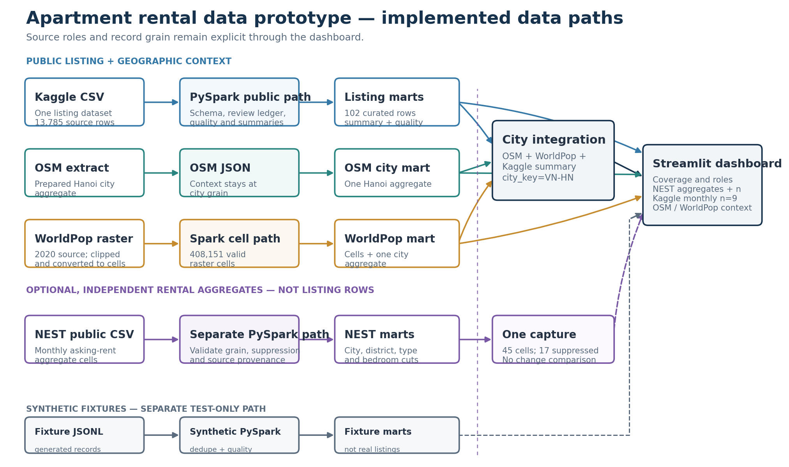
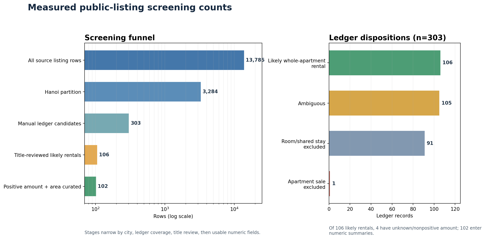
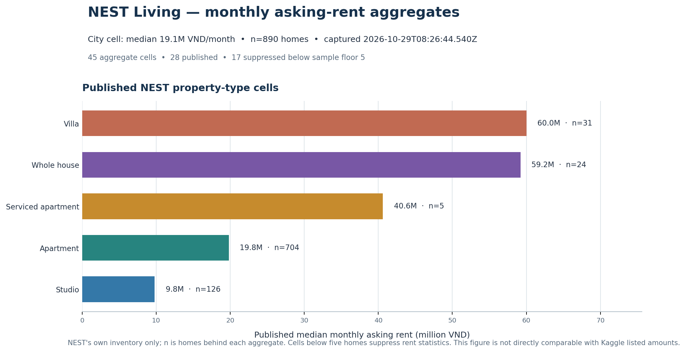

# Báo cáo đồ án cuối kỳ IT5427

**Đề tài:** *Multi-source Apartment Rental Data Integration and Analysis in Hanoi* 
**Ngày lập:** 2026-10-29 
**Phiên bản thực thi được đối chiếu:** public Spark manifest `public-20261029T083945Z`, NEST aggregate snapshot `nest-20261029T082644540Z`; PySpark 3.5.9

## 1. Tóm tắt dự án và mục tiêu

Đồ án xây dựng nguyên mẫu cục bộ để tiếp nhận, chuẩn hóa và phân tích dữ liệu liên quan đến căn hộ cho thuê tại Hà Nội. Mục tiêu kỹ thuật là dùng PySpark xử lý dữ liệu dạng bảng, giữ lại nguồn gốc và lý do loại dữ liệu, kết hợp dữ liệu niêm yết với bối cảnh địa lý ở độ phân giải có thể bảo vệ được, rồi trình bày kết quả qua Streamlit.

Kết quả hiện tại gồm nhánh fixture tổng hợp và nhánh dữ liệu công khai mang tính thăm dò. Nguồn listing duy nhất là Kaggle: Spark đọc **13.785 dòng**, trong đó **3.284 dòng thuộc tệp Hà Nội**, và giữ **102 dòng có tiêu đề được rà soát cùng giá trị diện tích và khoản tiền dương**; chỉ **9 dòng** có cơ sở giá tháng được xác minh. Một nhánh PySpark riêng nạp NEST Living như **nguồn độc lập do một publisher khác xuất bản ở grain tổng hợp**, không phải listing rows: snapshot CSV có **45 aggregate cells**, **28 cell được công bố**, **17 cell bị ẩn số liệu do cỡ mẫu nhỏ**, và một city cell gồm **890 homes**. OSM và WorldPop là dữ liệu bối cảnh địa lý. Chỉ OSM, WorldPop và tổng hợp Kaggle hiện được nối tại khóa thành phố; NEST được giữ ở các mart riêng vì phạm vi homes, thời điểm và định nghĩa không khớp đủ để ghép thành một thống kê chung.

Đây là nguyên mẫu xử lý dữ liệu trên một máy Windows, không phải hệ thống sản xuất. Bằng chứng hiện có không xác nhận ba nguồn niêm yết cho thuê độc lập, không đại diện toàn thị trường và không cho phép kết luận xu hướng giá toàn Hà Nội.

## 2. Bối cảnh vấn đề và phạm vi

Dữ liệu niêm yết bất động sản thường có cấu trúc và cách mô tả không đồng nhất. Trong bộ Kaggle được dùng, loại căn hộ và giao dịch thuê/bán không có trường cấu trúc riêng; một số thông tin chỉ xuất hiện trong tiêu đề. Trường `price` được mô tả bằng triệu VND nhưng kỳ hạn không được xác định cho phần lớn dòng. Trường `address` là văn bản tự do, không cung cấp mã quận/phường hoặc tọa độ đáng tin cậy để nối với dữ liệu địa lý.

Phạm vi triển khai gồm: rà soát nguồn và quyền sử dụng; tách fixture tổng hợp khỏi dữ liệu công khai; chuẩn hóa cột và xử lý chất lượng bằng PySpark; chuẩn bị bối cảnh OSM/WorldPop; ghi đầu ra Parquet; tạo dashboard có nhãn và cảnh báo phù hợp. Không xây dựng crawler, không dùng TiniX để suy đoán trạng thái thuê, không bổ sung ML hay hạ tầng phân tán.

Tệp Batdongsan.com.vn được rà soát thủ công ở giai đoạn trước chỉ là một pilot nhỏ, không đi vào run manifest công khai hiện tại. Các fixture của Batdongsan, Nhà Tốt và Homedy trong nhánh mặc định là dữ liệu tổng hợp, không phải các bản ghi thật.

## 3. Nguồn dữ liệu, giấy phép, xuất xứ, định dạng và giới hạn

| Nguồn | Vai trò và trạng thái | Định dạng, quy mô, bằng chứng | Giấy phép, xuất xứ và giới hạn |
|---|---|---|---|
| Vietnam House Rent Dataset, Van Viet Hieu Anh / Kaggle [1] | **CONDITIONAL; được dùng thăm dò**. Đây là nguồn listing duy nhất trong nhánh dữ liệu công khai. | Ba CSV tổng cộng **2.491.539 byte**. Tệp địa phương có **13.785 dòng**: Đà Nẵng 768, TP.HCM 9.733, Hà Nội 3.284. Các trường nguồn: `title`, `published`, `address`, `acreage`, `price`. Kaggle ghi lần cập nhật **2022-08-13**. | Theo hồ sơ kiểm tra dataset card ngày 2026-10-02, người tải lên khai báo **CC0**; lần truy cập hiện tại không trả nội dung trang Kaggle đủ để tái xác minh trực tiếp. Tuyên bố này không xác nhận người tải lên có quyền đối với nội dung bên thứ ba. README cấp repository của publisher nói các dataset được scrape từ websites; README riêng của house-rent chỉ mô tả các bài đăng cho thuê và không nêu website gốc. Bằng chứng primary này xác nhận publisher tự mô tả phương thức thu thập là scraping, nhưng không xác định nền tảng nguồn, quy trình chi tiết hay quyền đối với dữ liệu upstream. Các điểm đó vẫn chưa thể xác minh; dữ liệu thô được giữ cục bộ và không phân phối lại. README publisher liệt kê 5.000 dòng TP.HCM, nhưng CSV thực tế đã đọc có 9.733 dòng; báo cáo dùng số đếm từ tệp và run manifest, đồng thời ghi nhận sai khác metadata. |
| NEST Living Hanoi Rent Index [8][9] | **OPTIONAL; independent aggregate rental source**, separate from Kaggle. Not a listing-row source. | Intended public CSV download, **5,039 bytes**, **45 cells**: 1 city, 10 district, 29 district-by-bedroom, 5 property-type. 28 cells published; 17 small-sample cells retain counts but suppress median/quartiles. City cell: 890 NEST homes. Source capture **2026-10-29T08:26:44.540Z**; retrieved **2026-10-29T08:27:06.485Z**. | The page says the index covers NEST's own asking-rent inventory, not all Hanoi; medians are monthly VND and cells below five homes suppress rent statistics. Terms prohibit automated harvesting and copying listing content, but state no open license or explicit CSV reuse grant. The project used the page's intended aggregate CSV download once, did not crawl listings, preserves attribution and the terms caveat, and keeps the raw file out of Git/ZIP. Reuse status remains unclear; treat it as an optional local aggregate input. SHA-256 and full schema/profile are in `docs/nest_living_source_note.md`. |
| Geofabrik Vietnam / OpenStreetMap [2][3] | **ACCEPT cho bối cảnh địa lý**; không phải nguồn niêm yết. | PBF ghim `vietnam-260930.osm.pbf`, **329.495.536 byte**, dữ liệu đến **2026-09-30 20:22:42 UTC**, sequence 4925. Spark nhận một JSON tổng hợp Hà Nội 1.910 byte, không đọc PBF thành các dòng Spark. | OSM theo **ODbL 1.0**, cần ghi công OpenStreetMap contributors và liên kết giấy phép; các điều khoản share-alike có thể áp dụng cho cơ sở dữ liệu phái sinh được phân phối. Dashboard ghi công OSM. Bối cảnh hiện tại vẫn lấy từ snapshot 30/09/2026. |
| WorldPop Vietnam Population Counts 2020 [4][5] | **ACCEPT cho bối cảnh dân số**; không phải nguồn niêm yết. | GeoTIFF nguồn **196.897.622 byte**, tham chiếu năm 2020, độ phân giải 3 arc-second (xấp xỉ 100 m ở xích đạo). Bản cắt Hà Nội **1.559.619 byte**, raster 987 × 878; **408.151 ô hợp lệ**. | **CC BY 4.0**; ghi công WorldPop/University of Southampton và DOI `10.5258/SOTON/WP00645`. Đây là ước lượng mô hình theo ô raster, không phải số đếm điều tra tại từng địa chỉ. |
| TiniX Vietnam Real Estate Listings [6] | **REJECT cho phân tích giá thuê**; không nạp vào pipeline. | Publisher khai báo 3.500.744 dòng trong 10 Parquet shard, khoảng 1,67 GB. Phần xem trước 500 dòng có 160 Hà Nội và 41 bản ghi thuộc loại căn hộ có cấu trúc; trong nhóm căn hộ Hà Nội xem trước không có dòng thuê nào được xác minh. Không tải toàn bộ dữ liệu. | Dataset card khai báo **CC BY-NC 4.0**, nhưng không có trường giao dịch thuê/bán đáng tin cậy và không nêu rõ nền tảng niêm yết gốc. Không phân loại thuê từ mức giá hoặc từ khóa mô tả. |
| Batdongsan.com.vn — pilot thủ công G1 [7] | **CONDITIONAL; pilot riêng, không nằm trong mart công khai hiện tại**. | 3 bản ghi JSONL đã xem thủ công; 2 còn hoạt động, 1 qua kiểm tra hiện có và được giữ duy nhất theo mã nguồn. Pilot có giá dạng khoảng, dòng hết hạn và sai khác diện tích. | Đánh giá điều khoản chỉ hỗ trợ mẫu thủ công nhỏ, tối giản, dùng nội bộ; không phải giấy phép mở và không cho phép tự động thu thập hoặc mở rộng. Robots.txt không được xem là giấy phép. Không có crawler. |

Theo hồ sơ nguồn, Kaggle, TiniX và pilot Batdongsan được rà soát ngày **2026-10-02**; các trang chính thức Geofabrik, OSM và WorldPop được đối chiếu ngày **2026-10-03**. Các tệp Kaggle, PBF nền và GeoTIFF WorldPop trong manifest được tải ngày **2026-10-02 11:34:17 UTC**. Ngày kiểm tra/đối chiếu của từng tham chiếu được ghi lại trong danh mục tài liệu ở cuối báo cáo.

## 4. Bằng chứng 3V

| Thành phần | Bằng chứng đo được | Diễn giải và giới hạn |
|---|---|---|
| **Volume — Khối lượng** | Spark đọc **13.785** Kaggle rows; **3.284** Hanoi rows; ledger bao phủ **303** apartment-cue candidates; **102** dòng có amount/area dương. Nhánh NEST Spark đọc riêng **45 aggregate cells** (28 công bố, 17 suppressed). Spark xử lý **408.151** ô WorldPop và một aggregate OSM row. | Kaggle rows không phải giao dịch đã xác minh; NEST cells không phải listing records. Ô raster và OSM là khối lượng bối cảnh, không phải listing count. |
| **Variety — Đa dạng** | Kaggle listing CSV; NEST aggregate CSV với các cut city/district/bedroom/property type; OSM PBF tiền xử lý thành JSON và OSM batch diff; WorldPop GeoTIFF/cell CSV gzip; các Parquet marts ở grain riêng. | Đây là bằng chứng tích hợp nhiều nguồn/định dạng và giữ grain, gồm một publisher độc lập cho rent aggregates. NEST không được nối hay gộp thống kê với Kaggle. OSM/WorldPop vẫn là dữ liệu bối cảnh, không phải rental sources. |
| **Velocity — Tốc độ thay đổi** | Ngày đăng đọc được của 100/102 dòng Kaggle curated trải từ **2016-01-14 đến 2022-07-26**; Kaggle ghi cập nhật cuối **2022-08-13**. OSM có snapshot ngày 30/09 (seq. 4925), diff ngày 01/10 (seq. 4926) và ngày 02/10 (seq. 4927). NEST có đúng **một** CSV capture tại `2026-10-29T08:26:44.540Z`; WorldPop tham chiếu **2020**. | OSM là bằng chứng batch địa lý riêng; NEST chưa đủ hai snapshot CSV thật để so sánh. Không có listing feed hay repeat listing snapshot, nên rental-listing Velocity vẫn chưa được đo; không tuyên bố streaming. |

Số lượng tiền xử lý OSM cho bối cảnh Hà Nội là **201.686 highway ways**, xấp xỉ **34.342,71 km** chiều dài gắn thẻ, **5.048** điểm/đối tượng giao thông công cộng, **2.404** đối tượng giáo dục, **666** đối tượng y tế và **5.828** tiện ích khác. Đây là số feature theo thẻ OSM, không phải số cơ sở duy nhất; chiều dài gồm cả đường dịch vụ/lối đi và có thể chồng lặp.

## 5. Kiến trúc mục tiêu và pipeline đã triển khai

**Hình 1. Kiến trúc pipeline và dashboard đã triển khai.** Nhánh listing dùng Kaggle; nhánh NEST tùy chọn đọc CSV aggregate và ghi city/district/type marts riêng. OSM và WorldPop được tích hợp với tổng hợp Kaggle ở cấp thành phố qua `city_key=VN-HN`. Nhánh fixture tổng hợp chạy riêng.

`prepare_public_context.py` dùng Osmium/Shapely và Rasterio để tạo ranh giới, bộ đếm OSM và raster WorldPop cắt theo ranh giới Hà Nội; lệnh thông thường tái sử dụng các artefact hiện có. `prepare_worldpop_cells.py` chuyển các ô hợp lệ của raster cắt sang CSV gzip. PySpark chạy `local[2]`, hợp nhất các CSV Kaggle, áp dụng rà soát đã lưu, xử lý OSM JSON và bảng ô WorldPop, rồi ghi Parquet. `ingest_nest_rent_index.py` là lối nạp riêng: đọc một CSV đã tải thủ công, kiểm tra schema/timestamp/sample suppression và ghi các mart NEST riêng kèm provenance. Mã không tải tự động từ NEST. `compare_nest_snapshots.py` chỉ so sánh các snapshot đã đăng ký khi có hai capture khác nhau. Dashboard đọc các mart theo grain, không gắn aggregate NEST vào listing rows.

PBF đầy đủ không được đưa vào Spark dạng đối tượng từng hàng; Spark đọc một dòng JSON đã tiền xử lý. Tương tự, Spark đọc bảng CSV ô đã cắt thay vì raster GeoTIFF gốc. Nhánh synthetic sử dụng các tệp fixture JSONL riêng và không trộn với các dòng Kaggle.

## 6. Lược đồ chung, làm sạch, căn chỉnh lược đồ và xử lý chất lượng

Không có một lược đồ duy nhất được union giữa dữ liệu tổng hợp, niêm yết công khai, OSM và WorldPop. Mã duy trì các nhánh chuẩn hóa riêng theo mục đích:

- Trong nhánh synthetic, adapter của Batdongsan, Nhà Tốt và Homedy ánh xạ các tên trường nguồn thành `source`, `source_listing_id`, `source_url`, `title`, `price_raw`, `area_raw`, `bedrooms_raw`, `district_raw`, `property_subtype_raw`, `collected_at_raw` và `listing_status`. Các adapter được ghép bằng `unionByName(..., allowMissingColumns=True)`. Giá có kỳ tháng và đơn vị triệu/nghìn được chuẩn hóa sang VND/tháng; khoảng giá hoặc khoảng diện tích bị để thiếu để rà soát. Đây là dữ liệu fixture tổng hợp, không phải adapter được xác nhận cho thu thập thực tế.
- Trong nhánh public, ba CSV có cùng bộ trường nguồn được ghép bằng `unionByName`. Pipeline thêm tên partition, nguồn và một fingerprint SHA-256 để khớp ledger rà soát. Lược đồ curated gồm thành phố và `city_key`, nguồn, fingerprint, khoản niêm yết (triệu VND và VND), diện tích, ngày đăng thô/đã phân tích, trạng thái xác minh kỳ giá, `verified_monthly_rent_vnd` khi đủ bằng chứng, loại căn hộ và cơ sở phân loại.
- Tiêu đề được chuẩn hóa dấu tiếng Việt trước khi dò từ khóa căn hộ, thuê và bán. Nhãn thuê/bán không được suy từ độ lớn của giá. Ledger thủ công xử lý tiêu đề mơ hồ, phòng ở/chia sẻ và các trường hợp đã lấy mẫu. Những dòng mơ hồ hoặc không thuộc apartment rental bị loại khỏi số liệu giá.
- Trường `published` được đọc theo định dạng ngày `dd/MM/yyyy`; 100 trong 102 dòng curated chuyển thành ngày lịch. Mã nhân giá có cấu trúc tính bằng triệu VND với 1.000.000 để tạo khoản tiền VND, nhưng không gán kỳ tháng nếu không có bằng chứng riêng.

Ledger nhãn không bao phủ toàn bộ partition Hà Nội: chỉ **303/3.284** dòng có mục ledger, còn **2.981** dòng không được gán nhãn thủ công. Sau hiệu chỉnh, ledger gồm 106 include, 105 ambiguous, 91 loại do phòng/chia sẻ và 1 trường hợp bán căn hộ.

Kiểm định thủ công dùng mẫu ngẫu nhiên không hoàn lại từ kết quả bộ phân loại ban đầu: 50/105 dự đoán dương (seed 5427) có 49 tiêu đề rõ là căn hộ cho thuê và 1 mơ hồ; 100/3.179 dự đoán âm (seed 25427) có 2 trường hợp bỏ sót được xác nhận, 6 mơ hồ và 92 không có bằng chứng thuê rõ. Precision bảo thủ của mẫu dương là **49/50 = 98%**, không phải độ chính xác toàn bộ dữ liệu. Mẫu âm không đủ cơ sở để báo recall dân số; báo cáo không đưa ra recall.

Bảng chất lượng Spark có 10 trạng thái, tổng cộng đúng 13.785 dòng:

| Trạng thái chất lượng | Số dòng |
|---|---:|
| Ngoài partition Hà Nội | 10.501 |
| Có cue thuê nhưng không phải căn hộ | 2.213 |
| Không có cue căn hộ/giao dịch | 749 |
| Giao dịch căn hộ chưa rõ | 80 |
| Cần rà soát thủ công, còn mơ hồ | 25 |
| Phòng/chia sẻ hoặc lưu trú ngắn hạn bị loại | 91 |
| Có cue bán nhưng không phải căn hộ | 19 |
| Bán căn hộ bị loại | 1 |
| Có nhãn khả năng thuê nhưng giá không dùng được | 4 |
| Bản ghi thăm dò hợp lệ về tiêu đề, giá và diện tích | 102 |

**Hình 2. Funnel sàng lọc listing công khai theo số đếm đo được.** Trong 13.785 dòng nguồn, 3.284 thuộc partition Hà Nội; ledger thủ công bao phủ 303 ứng viên có cue căn hộ. Ledger đánh dấu 106 tiêu đề là khả năng cho thuê căn hộ nguyên căn; 4 dòng không có khoản tiền dương dùng được nên bị loại khỏi tổng hợp số học, còn 102 dòng có cả khoản tiền và diện tích dương. 2.981 dòng Hà Nội còn lại không có nhãn ledger thủ công; các bước không biểu thị kết quả đã xác minh giao dịch.

Ledger kỳ giá ghi nhận 11 tiêu đề có số tiền gắn rõ với kỳ tháng; 9 khớp trường giá cấu trúc (một trường hợp khớp mức thấp của khoảng giá), 1 không khớp và 1 có giá `-1`/không xác định. Trong 102 dòng có số liệu, **92 có kỳ giá chưa biết, 9 có kỳ tháng được xác minh, 1 có chữ tháng nhưng giá không khớp**. Không quan sát được kỳ tuần/ngày rõ ràng trong đợt rà soát này.

## 7. Xử lý Spark, lưu trữ và tích hợp

Các số liệu Kaggle/OSM/WorldPop dưới đây lấy từ manifest **`public-20261029T083945Z`**. Byte Parquet là tổng dung lượng `part-*.parquet`, không tính marker thành công hoặc CRC phụ trợ. NEST được nạp bởi job riêng và không nằm trong các thời gian public pipeline này.

| Nguồn/bảng | Đầu vào thực tế của Spark | Đầu ra Parquet | Thời gian Spark |
|---|---|---|---:|
| Kaggle → curated listing | 13.785 dòng CSV; tệp CSV tổng 2.491.539 byte; 3.284 dòng thuộc Hà Nội | 102 dòng, **13.883 byte** | **73,635 s** |
| OSM → city context | JSON tổng hợp 1 dòng, **1.910 byte**; PBF nguồn là 329.495.536 byte nhưng đã được xử lý ngoài bước Spark này | 1 dòng Hà Nội, **7.034 byte** | **1,545 s** |
| WorldPop → cell table | CSV gzip 408.151 dòng, **3.120.702 byte**; raster gốc 196.897.622 byte, clip 1.559.619 byte | 408.151 ô, **3.410.996 byte**; aggregate thành phố 1 dòng, **2.240 byte** | **6,391 s** |
| Tích hợp theo khóa thành phố | Một OSM aggregate và một WorldPop aggregate; listing summary cũng có một dòng | `city_context`: 1 dòng/**8.595 byte**; `integrated_city`: 1 dòng/**12.864 byte** | **26,073 s** |
| Summary và chất lượng niêm yết | Tổng hợp listing; group theo disposition | Summary: 1 dòng/**4.871 byte**; quality: 10 dòng/**1.085 byte** | Nằm trong thời gian bước listing |
| NEST Living aggregate | CSV thủ công **45 cell**; 1 city, 10 district, 29 district-bedroom, 5 property type | Các mart riêng theo grain; 28 công bố, 17 suppressed | Job PySpark riêng; không nhập vào thời gian Kaggle/OSM/WorldPop |

Tổng Spark trong manifest (`total_spark_seconds`) là **109,395 giây**. Bốn stage timers trong bảng cộng thành **107,644 giây**; tổng trong manifest là thước đo tổng thể được ghi riêng. Khoảng `started_at_utc`–`completed_at_utc` của lệnh public là **119,968 giây** (khoảng 2 phút), gồm khởi động và phần nằm ngoài các bộ định thời stage. Lần chạy này tái sử dụng bản tổng hợp OSM cùng raster WorldPop đã có, không quét lại PBF/raster. Đây là một lần chạy cục bộ, không phải benchmark ổn định.

Tích hợp dùng đúng một khóa cùng cấp là `city_key=VN-HN`. Bảng city context ghép OSM với aggregate WorldPop; `integrated_city` nối aggregate listing với city context. Không có trường OSM hoặc WorldPop nào được thêm vào từng listing. Kiểm tra văn bản địa chỉ tìm thấy 52/106 tiêu đề dương có một quận được đánh dấu duy nhất, nhưng không đủ để tạo phép nối hành chính đáng tin cậy; pipeline không gán quận/phường và không tạo kết quả cấp khu phố.

## 8. Khử trùng lặp và phân giải thực thể

Ở nhánh synthetic, sau lọc chất lượng, mã dùng `dropDuplicates(["source", "source_listing_id"])` để khử trùng lặp theo mã nguồn bên trong từng nguồn fixture. Pilot Batdongsan riêng cũng có mã nguồn quan sát được và được đánh giá ở phạm vi ba bản ghi.

Ở nhánh Kaggle public, bộ dữ liệu không có ID niêm yết ổn định. SHA-256 trên partition thành phố và các trường tiêu đề/ngày đăng/địa chỉ/diện tích/giá tạo `source_fingerprint` để nối bản ghi với ledger nhãn và kỳ giá. Fingerprint này **không** được dùng để khử trùng lặp trong public path. Không có entity resolution liên nguồn, khử bản sao giữa nền tảng, hay đối chiếu listing Kaggle với Batdongsan/TiniX.

## 9. Kết quả phân tích và dashboard

Với 102 dòng có khoản tiền và diện tích, median **listed amount** là **3.500.000 VND**, median diện tích **30 m²**, và median **listed amount per m²** là **120.000 VND/m²**. Kỳ giá chưa biết với 92/102 dòng; vì vậy các số tổng hợp này không được gọi là tiền thuê tháng hay giá giao dịch.

Tập con tháng đã xác minh có **n=9**: median **3.200.000 VND/tháng**, median diện tích **25 m²**, median **133.333,33 VND/m²/tháng**. Đây là kết quả thăm dò từ một tập nhỏ, cũ và không đại diện. 11 tiêu đề có số tiền theo tháng; một giá mâu thuẫn và một giá không xác định không được dùng trong thống kê tháng.

Dashboard Streamlit có hai lựa chọn rõ ràng:

1. **Synthetic fixtures:** hiển thị dữ liệu tổng hợp, có cảnh báo rằng không đại diện listing hay thị trường Hà Nội.
2. **Public-data prototype:** hiển thị 102 dòng Kaggle, quality counts, nhãn “listed amount”/“listed amount per m²”, tập con tháng n=9 có cảnh báo cỡ mẫu nhỏ, độ phủ từng nguồn, NEST aggregates kèm sample size/snapshot date, và bối cảnh OSM/WorldPop ở grain thành phố. NEST không được so sánh trực tiếp với các khoản tiền Kaggle.

**Hình 3. Aggregate asking-rent NEST theo loại bất động sản, dữ liệu được vẽ trực tiếp từ CSV capture ngày 2026-10-29.** Nhãn `n` là số homes đứng sau mỗi median. NEST chỉ mô tả inventory của chính publisher; đây không phải listing-level data và không được so sánh trực tiếp với khoản tiền Kaggle. Các ô dưới ngưỡng năm homes giữ lại count nhưng bị suppress median/quartiles.

Các số bối cảnh gồm WorldPop tổng ước lượng **8.440.532,41** người theo raster 2020, cùng các feature OSM đã nêu ở Mục 4. Đây là hai nguồn bối cảnh riêng; dashboard nêu rõ không nối ở cấp listing hoặc khu phố. Không có phân tích tác động của tiện ích lân cận lên giá.

## 10. Thử nghiệm và xác minh

Các kết quả kiểm tra được ghi trong báo cáo chất lượng và manifest hiện có:

| Kiểm tra | Kết quả ghi nhận |
|---|---|
| `py_compile` | Chạy ngày 2026-10-29 sau các thay đổi; kiểm tra các pipeline, dashboard, NEST ingestion/snapshot scripts, preparation scripts, và report/deck builders. |
| `python pipeline.py` | Chạy ngày 2026-10-29: `raw rows=7, active rows=7, valid rows=5, unique listings=4`; chỉ dùng fixture tổng hợp. |
| `python pipeline.py --dataset public` | Manifest `public-20261029T083945Z`: 13.785 raw, 3.284 Hà Nội, 102 curated, 408.151 ô WorldPop, 1 dòng tích hợp thành phố; quality table cộng đúng 13.785. Spark 109,395 giây; manifest elapsed 119,968 giây. |
| NEST ingestion và capture check | PySpark đọc 45 aggregate cells: 1 city, 10 district, 29 district-bedroom, 5 property type; 28 công bố và 17 suppressed. Comparison báo `insufficient_snapshots` với 1 capture thật; không có thay đổi nào được suy ra. |
| Streamlit AppTest | Chạy ngày 2026-10-29: cả Synthetic fixtures và Public-data prototype không có exception. Public view hiển thị cảnh báo Kaggle n=9, source coverage, NEST city/type aggregates và thông báo cần capture thứ hai. |
| Máy chủ Streamlit | Kiểm tra HTTP local trả status 200 cho public view; figure trong báo cáo là biểu đồ data-derived từ CSV, không phải ảnh chụp giao diện. |
| So sánh/replay OSM seq. 4927 (hồ sơ kiểm tra trước) | Hồ sơ ngày 2026-10-03 ghi nhận so seq. 4926: 14.572 tạo, 5.901 sửa, 2.284 xóa; 22.757 thao tác duy nhất, không trùng. Kiểm tra point-in-polygon node context Hà Nội: 1 tạo, 62 sửa, 6 xóa; không xác định geometry way. Replay hai lần cho manifest/counts nghiệp vụ giống nhau (0,549 s và 0,511 s). Đây là kiểm tra lưu trong repo, không được chạy lại trong xác minh ngày 2026-10-29. |

Các thời gian và kết quả Spark chỉ phản ánh một lần chạy trên máy Windows cục bộ ngày 2026-10-29 với `local[2]`, PySpark 3.5.9 và 2 shuffle partitions. NEST được chạy bằng lệnh riêng. Không có benchmark cluster, thử tải đồng thời, kiểm tra mở rộng ngang hoặc so sánh với hệ thống phân tán sản xuất. Vì vậy không suy rộng những thời gian trên thành bằng chứng về hiệu năng production-scale.

## 11. Hạn chế, đạo đức sử dụng dữ liệu và công việc tiếp theo

- **Nguồn listing:** chỉ một dataset niêm yết hướng đến cho thuê được đưa vào nhánh public. Kaggle uploader khai báo CC0, nhưng tên các website gốc không được cung cấp; quyền đối với nội dung upstream và dữ liệu cá nhân không được giải quyết chỉ bởi tuyên bố đó. Không phát hành CSV thô, tiêu đề hoặc địa chỉ chi tiết.
- **Nguồn aggregate NEST:** đây là nguồn thuê độc lập của publisher khác nhưng chỉ chứa thống kê aggregate từ inventory NEST, không chứa listing records. Terms không nêu open license hay quyền tái sử dụng CSV rõ ràng; do đó dữ liệu được giữ là input cục bộ tùy chọn, có attribution và caveat, raw CSV không được đưa vào Git hoặc ZIP. Không khẳng định dữ liệu này bao phủ toàn thị trường hay không trùng lặp với upstream Kaggle chưa rõ.
- **Nhãn và giá:** bộ lọc tiêu đề có thể bỏ sót hoặc gán nhầm. Ledger thủ công bao phủ 303/3.284 dòng, audit mẫu nhỏ; 98% chỉ là precision ước lượng của mẫu dương ban đầu, không phải độ chính xác toàn tập, và không có recall. Giá của đa số bản ghi không có kỳ hạn rõ.
- **Không gian:** địa chỉ là văn bản tự do. Không có tọa độ hoặc district/ward ID đáng tin cậy. Bối cảnh địa lý chỉ ở cấp Hà Nội; không suy luận hiệu ứng giá cấp khu phố hay mức độ tiếp cận từ địa chỉ chính xác.
- **Độ mới:** Kaggle là snapshot cũ; WorldPop là sản phẩm tham chiếu năm 2020. NEST hiện có một capture aggregate, chưa đủ để tính thay đổi qua thời gian. OSM có hai batch diff đã kiểm tra nhưng tổng hợp Hà Nội chưa được tính lại theo snapshot mới hơn. Batch OSM không đo biến động listing thuê.
- **Chất lượng context:** OSM không đầy đủ đồng đều; feature có thể chưa được ghi nhận hoặc trùng loại thực thể. WorldPop là phân bổ dân số ước tính trên ô raster, không phải số dân quan sát trực tiếp.
- **Quyền sử dụng:** cần giữ attribution OSM theo ODbL và WorldPop theo CC BY 4.0. Với Kaggle, tiếp tục giữ nguồn thô cục bộ và không phân phối lại cho đến khi quyền nguồn gốc được làm rõ. Với NEST, giữ attribution và terms caveat; reuse grant không được nêu rõ. Raw NEST CSV, output cục bộ và ledger nằm ngoài Git theo `.gitignore`; raw CSV cũng không có trong ZIP.

Công việc tiếp theo nên ưu tiên xác nhận tiêu chí của giảng viên về “multi-source”, xin một nguồn listing dòng có xuất xứ/quyền rõ nếu cần, cải thiện nhãn từ field hoặc mẫu được xác minh, và chỉ thử so sánh theo thời gian khi có các snapshot listing được phép lưu. Mọi mở rộng phạm vi đề tài cần được giảng viên chấp thuận trước; báo cáo này không tự giả định yêu cầu môn học chưa được ghi nhận trong repository.

## 12. Kết luận và tài liệu tham khảo

Đồ án triển khai pipeline Spark cục bộ cho fixture tổng hợp và nguyên mẫu public-data: Kaggle là một listing dataset, NEST là một nguồn independent aggregate asking-rent riêng, còn OSM/WorldPop cung cấp geographic context. OSM–WorldPop–Kaggle summary tích hợp ở cấp thành phố; NEST giữ marts city/district/type riêng. Bằng chứng 3V cho thấy khối lượng xử lý hữu hạn, đa dạng định dạng và thay đổi batch OSM. Kết quả thuê còn sơ bộ: chỉ chín dòng Kaggle có kỳ tháng xác minh; NEST mô tả inventory của publisher và mới có một snapshot. Đây là prototype tích hợp nhiều nguồn có grain rõ, không phải ba nền tảng listing, không phải streaming hay phân tích đại diện thị trường Hà Nội.

### Tài liệu tham khảo và ngày truy cập

1. Van Viet Hieu Anh, [Vietnam House Rent Dataset, Kaggle](https://www.kaggle.com/datasets/vanviethieuanh/vietnam-house-rent-dataset); [publisher repository-level README](https://github.com/vanviethieuanh/dataset/blob/main/README.md), which states that datasets are scraped from websites; [house-rent schema README](https://github.com/vanviethieuanh/dataset/blob/main/house-rent/README.md). Kaggle card accessed **2026-10-02**; publisher READMEs checked **2026-10-03**; CSVs downloaded **2026-10-02**. Kaggle metadata records the uploader-declared CC0 license; see [CC0 1.0 Universal](https://creativecommons.org/publicdomain/zero/1.0/).
2. Geofabrik, [Download OpenStreetMap data for Vietnam](https://download.geofabrik.de/asia/vietnam.html) và [technical details for extracts/updates](https://download.geofabrik.de/technical.html), truy cập **2026-10-03**. Snapshot nền PBF được tải **2026-10-02**; manifest ghi thời điểm dữ liệu, sequence, checksum và kích thước.
3. OpenStreetMap Foundation, [Copyright and License](https://www.openstreetmap.org/copyright), truy cập **2026-10-03**; Open Data Commons, [ODbL v1.0 legal text](https://opendatacommons.org/licenses/odbl/1-0/), truy cập **2026-10-03**.
4. WorldPop, [Vietnam Population Counts, 2020 (dataset 6449)](https://hub.worldpop.org/geodata/summary?id=6449), truy cập **2026-10-03**; raw GeoTIFF tải **2026-10-02**. DOI: [10.5258/SOTON/WP00645](https://doi.org/10.5258/SOTON/WP00645).
5. Creative Commons, [Attribution 4.0 International](https://creativecommons.org/licenses/by/4.0/), truy cập **2026-10-03**.
6. TiniX AI, [Vietnam Real Estate Listings, Hugging Face](https://huggingface.co/datasets/tinixai/vietnam-real-estates), dataset card/schema được rà soát **2026-10-02**; [CC BY-NC 4.0](https://creativecommons.org/licenses/by-nc/4.0/) deed đối chiếu **2026-10-03**. Corpus đầy đủ không được tải.
7. Batdongsan.com.vn, [điều khoản thỏa thuận](https://trogiup.batdongsan.com.vn/docs/dieu-khoan-thoa-thuan) và [robots.txt](https://batdongsan.com.vn/robots.txt), kiểm tra **2026-10-02**; chi tiết pilot và quyết định sử dụng trong `docs/source_audit.md`.
8. NEST Living, [Hanoi Rent Index methodology and public CSV link](https://nestliving.vn/rent-index) and [Terms](https://nestliving.vn/terms), accessed **2026-10-29**. CSV downloaded through its intended public link once at **2026-10-29T08:27:06.485Z**; profile, SHA-256, schema and reuse assessment are in `docs/nest_living_source_note.md`.
9. Tài liệu repository: `README.md`, `pipeline.py`, `dashboard.py`, `ingest_nest_rent_index.py`, `compare_nest_snapshots.py`, `public_data_manifest.json`, `data/public_pilot/mart/run_manifest.json`, `data/public_pilot/snapshot_comparison/vietnam-261001_to_261002.json`, `docs/source_audit.md`, `docs/dataset_source_validation.md`, `docs/source_gap_and_alternatives.md`, `docs/data_quality_and_analysis_review.md`, `docs/public_data_implementation.md` và `docs/demo_runbook.md`.

### Các quyết định còn mở

- Giảng viên có chấp nhận **một listing dataset, một independent aggregate rental source, và hai dataset bối cảnh địa lý** là “multi-source” cho đề tài hay không?
- Nếu cần nhiều nguồn listing độc lập, tiêu chí chứng minh quyền sử dụng, xuất xứ nền tảng và đủ số bản ghi nào được chấp nhận?
- Có cần thu thập snapshot listing lặp lại để đáp ứng Velocity, hay bằng chứng batch OSM chỉ được xem là bối cảnh và không tính vào yêu cầu này?
