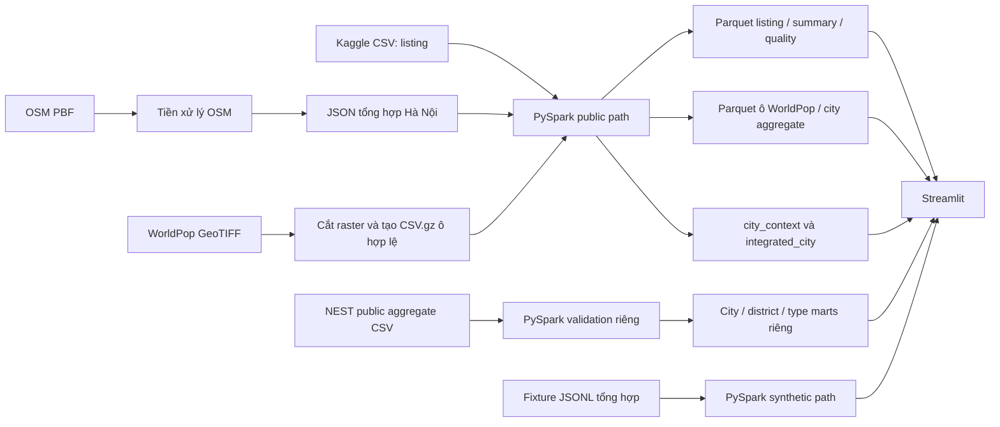

# Dàn ý thuyết trình đồ án IT5427

**Thời lượng mục tiêu:** 7–10 phút; dàn ý dưới đây khoảng **8 phút 50 giây**. 
**Cơ sở số liệu:** public manifest `public-20261029T083945Z`, NEST snapshots `nest-20261029T082644540Z` và `nest-20261029T091525078Z`, comparison output và các báo cáo QA trong repository.

## Slide 1 — Đề tài và mục tiêu (0:00–0:25)

**Chữ trên slide**

- *Multi-source Apartment Rental Data Integration and Analysis in Hanoi*
- Nguyên mẫu tích hợp dữ liệu listing, rental aggregates và geographic context
- Trọng tâm: PySpark, chất lượng, grain và lineage

**Hình gợi ý:** Tiêu đề cùng sơ đồ nhỏ gồm listing, OSM, WorldPop và dashboard.

**Ghi chú nói:** Giới thiệu đây là prototype của đồ án. “Multi-source” hiện có một dataset listing, một nguồn độc lập cung cấp rental aggregates, và hai nguồn context; NEST không cung cấp listing records.

## Slide 2 — Bài toán và phạm vi (0:25–1:10)

**Chữ trên slide**

- Dữ liệu niêm yết có trường văn bản và cách ghi giá không đồng nhất
- Cần làm sạch, căn chỉnh, truy vết và tích hợp theo khóa có thể bảo vệ
- Phân tích thăm dò; không ước lượng toàn thị trường

**Hình gợi ý:** Chuỗi “CSV thô → chuẩn hóa → quality disposition → Parquet → dashboard”.

**Ghi chú nói:** Dataset listing không có trường cấu trúc cho loại căn hộ, trạng thái thuê/bán hay đơn vị thời gian của phần lớn giá. Phạm vi là xử lý và tích hợp; không có crawler hay ML.

## Slide 3 — Nguồn và trạng thái sử dụng (1:10–2:05)

**Chữ trên slide**

| Đầu vào | Vai trò | Trạng thái và giới hạn chính |
|---|---|---|
| Kaggle Vietnam House Rent Dataset | Listing | Thăm dò; uploader khai báo CC0; publisher nói đã scrape từ websites, nhưng website gốc và quyền upstream chưa rõ |
| NEST Living Hanoi Rent Index | Rental aggregates | 45 aggregate cells từ inventory NEST; 28 published, 17 small-sample cells suppressed; terms không nêu open reuse license, optional local input |
| Geofabrik / OpenStreetMap | Bối cảnh địa lý | ODbL 1.0; snapshot 2026-09-30 |
| WorldPop Vietnam 2020 | Bối cảnh dân số | CC BY 4.0; ước lượng theo raster |
| TiniX | Candidate listing | Loại khỏi phân tích thuê; không xác định thuê/bán đáng tin cậy |
| Batdongsan pilot G1 | Pilot thủ công riêng | 3 dòng; không phải nguồn pipeline hiện tại |

**Hình gợi ý:** Bảng vai trò với ba biểu tượng khác nhau: bảng listing, bản đồ OSM, raster dân số.

**Ghi chú nói:** Kaggle vẫn là nguồn listing duy nhất; NEST là nguồn independent aggregate rental data, không phải listing rows. NEST methodology nói về asking-rent từ inventory của chính publisher và suppress statistics dưới sample floor; terms không nêu quyền tái sử dụng CSV rõ. Không crawl listings. TiniX và pilot Batdongsan không đi vào marts hiện tại. Đặt Kaggle, NEST methodology/terms, Geofabrik/OSM copyright và WorldPop/DOI ở slide tài liệu tham khảo.

## Slide 4 — Bằng chứng 3V (2:05–2:50)

**Chữ trên slide**

| V | Bằng chứng hiện có | Giới hạn |
|---|---|---|
| Volume | Kaggle 13.785 dòng; 3.284 Hà Nội; 102 curated; NEST 45 aggregate cells (17 suppressed); 408.151 ô WorldPop | Context cells và NEST cells không phải listing count |
| Variety | Kaggle CSV, NEST aggregate CSV, OSM PBF/JSON/diff, WorldPop GeoTIFF/CSV.gz, separate Parquet marts | NEST là một nguồn aggregate độc lập; không được gộp vào Kaggle |
| Velocity | OSM seq. 4926: 9.555/6.385/1.969; seq. 4927: 14.572/5.901/2.284 create/modify/delete; NEST 2 captures, 7/45 aggregate cells changed | NEST change là thay đổi chỉ số aggregate, không phải listing Velocity; không có repeat listing snapshot hoặc streaming |

**Hình gợi ý:** Ba cột Volume / Variety / Velocity; dùng màu khác nhau cho listing và context.

**Ghi chú nói:** Volume gồm đầu vào ở các grain khác nhau. OSM cho thấy thay đổi batch địa lý; hai NEST captures cho phép so sánh aggregate cells và ghi nhận 7 cell thay đổi, 38 cell không đổi, không thêm/bớt. Dự án vẫn chưa đo độ mới hoặc tốc độ thay đổi của individual rental listings.

## Slide 5 — Kiến trúc xử lý (2:50–3:50)

**Chữ trên slide**

- Tách nhánh synthetic và public
- Tiền xử lý địa lý riêng; Spark xử lý bảng và tổng hợp
- Parquet làm đầu ra; Streamlit đọc mart

**Hình gợi ý:** Sơ đồ kiến trúc dưới đây.

**Ghi chú nói:** OSM PBF được tiền xử lý trước thành một dòng summary JSON; Spark không đọc toàn bộ PBF thành các dòng. WorldPop được chuyển thành các dòng ô hợp lệ trước khi Spark đọc. NEST được nạp từ CSV đã tải thủ công, giữ grain aggregate và không nối vào listing summary. Dữ liệu fixture chạy trên đường riêng.

## Slide 6 — Schema alignment và chất lượng (3:50–4:45)

**Chữ trên slide**

- Listing CSV: `title`, `published`, `address`, `acreage`, `price`
- 303/3.284 dòng Hà Nội có mục trong ledger thủ công
- 106 title-positive; 102 có khoản tiền và diện tích dương
- Precision mẫu dương: 49/50 = 98%; không báo recall

**Hình gợi ý:** Sankey hoặc funnel 3.284 → 303 ledger candidates → 106 title-positive → 102 numeric curated; ghi chú “candidate, không phải giao dịch xác minh”.

**Ghi chú nói:** Pipeline chuẩn hóa dấu tiêu đề rồi dùng cue thuê, bán và căn hộ; ledger lưu quyết định thủ công. Mẫu dương 50 dòng có một dòng mơ hồ được tính bảo thủ là không đúng. Mẫu âm 100 dòng có hai trường hợp bỏ sót xác nhận và sáu mơ hồ; mẫu nhỏ này không đủ để ước lượng recall dân số.

## Slide 7 — Spark, lưu trữ và tích hợp (4:45–5:45)

**Chữ trên slide**

- PySpark 3.5.9, `local[2]`; tổng Spark 109,395 giây; manifest elapsed public 119,968 giây
- Listing: 13.785 input → 102 Parquet rows / 13.883 byte
- WorldPop: 408.151 ô → 3.410.996 byte Parquet
- Tích hợp ở `city_key=VN-HN`, mỗi aggregate một dòng

**Hình gợi ý:** Bảng grain/rows hoặc sơ đồ hai aggregate context + listing summary → một dòng `integrated_city`.

**Ghi chú nói:** 26,073 giây là giai đoạn tích hợp theo manifest; tổng bộ định thời Spark là 109,395 giây và manifest elapsed là 119,968 giây. NEST job là lệnh riêng và không tính trong đây. Kết quả đo trên một máy Windows với Spark local, không phải benchmark cluster. Listing không có tọa độ hoặc mã quận/phường đáng tin cậy nên không gắn context vào từng dòng.

## Slide 8 — Khử trùng lặp và phân giải thực thể (5:45–6:20)

**Chữ trên slide**

- Synthetic: dedupe theo `(source, source_listing_id)`
- Public: fingerprint chỉ nối dòng với ledger
- Không dedupe public; không cross-platform entity resolution

**Hình gợi ý:** Hai nhánh “fixture: ID-based dedupe” và “Kaggle: fingerprint → review ledger”.

**Ghi chú nói:** SHA-256 public fingerprint ghép partition thành phố và các trường tiêu đề/ngày/địa chỉ/diện tích/giá. Nó không phải listing ID ổn định và không chứng minh hai dòng từ các nền tảng khác nhau là cùng một thực thể.

## Slide 9 — Phân tích và dashboard (6:20–7:15)

**Chữ trên slide**

- Median khoản niêm yết: 3.500.000 VND; kỳ hạn thường chưa biết
- Median `listed amount per m²`: 120.000 VND/m²
- 9 dòng có kỳ tháng được xác minh: median 3.200.000 VND/tháng
- NEST city cell: median 19,1M VND/tháng, n=894; p25=12,7M, p75=30,5M; type cells show their own n
- Two NEST captures: 7/45 aggregate cells changed; 38 unchanged, 0 added/removed (not listing Velocity)
- OSM và WorldPop hiển thị riêng ở cấp thành phố

**Hình gợi ý:** Biểu đồ NEST monthly asking-rent theo property type có sample-size labels; dashboard source-coverage table. Không đặt NEST và Kaggle lên cùng thang so sánh.

**Ghi chú nói:** Trong 102 dòng Kaggle số học, 92 chưa rõ time basis và chỉ 9 có kỳ tháng xác minh. NEST city median 19,1 triệu VND/tháng dựa trên 894 NEST homes tại capture `2026-10-29T09:15:25.078Z`; p25 là 12,7M và p75 là 30,5M. Comparison giữa hai captures ghi nhận 7 aggregate cells thay đổi. Đây là NEST inventory, không phải thị trường và không so sánh trực tiếp với Kaggle. Population là ước lượng WorldPop năm 2020.

## Slide 10 — Thử nghiệm và bằng chứng batch OSM (7:15–8:10)

**Chữ trên slide**

- Synthetic: 7 raw / 5 valid / 4 unique
- Dashboard AppTest: hai chế độ không exception; HTTP 200 kiểm tra 2026-10-29
- NEST: 2 genuine captures; 45 shared cells, 7 changed, 38 unchanged, 0 added/removed; 28 published, 17 suppressed in each capture
- OSM seq. 4927: 14.572 create / 5.901 modify / 2.284 delete
- Replay: counts ổn định; 0,549 s và 0,511 s

**Hình gợi ý:** Ảnh terminal/manifest cùng đường thời gian OSM 4925 → 4926 → 4927.

**Ghi chú nói:** Public run và Parquet hiện tại có lineage trong manifest. Replay kiểm tra xử lý batch lặp lại theo kết quả nghiệp vụ; timestamp và runtime thay đổi. Những thay đổi đó là OSM toàn Việt Nam. NEST comparison chỉ ghi nhận aggregate-cell differences; cả hai nguồn đều không đo thay đổi individual rental listings và không cấu thành streaming.

## Slide 11 — Kết luận và quyết định còn mở (8:10–8:50)

**Chữ trên slide**

- Prototype có một listing dataset, một independent aggregate rental source, hai geographic context sources
- Không có neighborhood enrichment hay market-wide conclusion
- Cần xác nhận giảng viên chấp nhận source roles hiện tại; NEST không phải listing source thứ hai

**Hình gợi ý:** Ba ô “đã làm / còn thiếu / quyết định tiếp theo”.

**Ghi chú nói:** Kết quả chứng minh một quy trình tích hợp và xử lý trên máy cục bộ, không chứng minh quy mô production. Bước tiếp theo là xác nhận tiêu chí đề tài; nếu cần thêm listing source, cần nguồn có quyền và provenance rõ. NEST terms hiện chưa nêu reuse grant rõ cho CSV.

## Câu kết đề xuất

“Dự án chứng minh pipeline tích hợp đa định dạng với grain rõ ràng: một listing dataset, một nguồn aggregate rental độc lập và hai nguồn context. Kết quả giá vẫn thăm dò; chỉ chín khoản Kaggle có kỳ tháng xác minh, còn so sánh hai NEST captures ghi nhận bảy aggregate cells thay đổi, không phải rental-listing Velocity.”

## Liên kết nguồn để đặt ở slide tài liệu tham khảo

- Kaggle: [dataset](https://www.kaggle.com/datasets/vanviethieuanh/vietnam-house-rent-dataset), [publisher repository README](https://github.com/vanviethieuanh/dataset/blob/main/README.md), [house-rent schema README](https://github.com/vanviethieuanh/dataset/blob/main/house-rent/README.md)
- OSM: [Geofabrik Vietnam extract](https://download.geofabrik.de/asia/vietnam.html), [copyright and license](https://www.openstreetmap.org/copyright)
- WorldPop: [Vietnam Population Counts 2020](https://hub.worldpop.org/geodata/summary?id=6449), DOI [10.5258/SOTON/WP00645](https://doi.org/10.5258/SOTON/WP00645)
- NEST Living: [Hanoi Rent Index methodology and public CSV](https://nestliving.vn/rent-index), [terms](https://nestliving.vn/terms)
